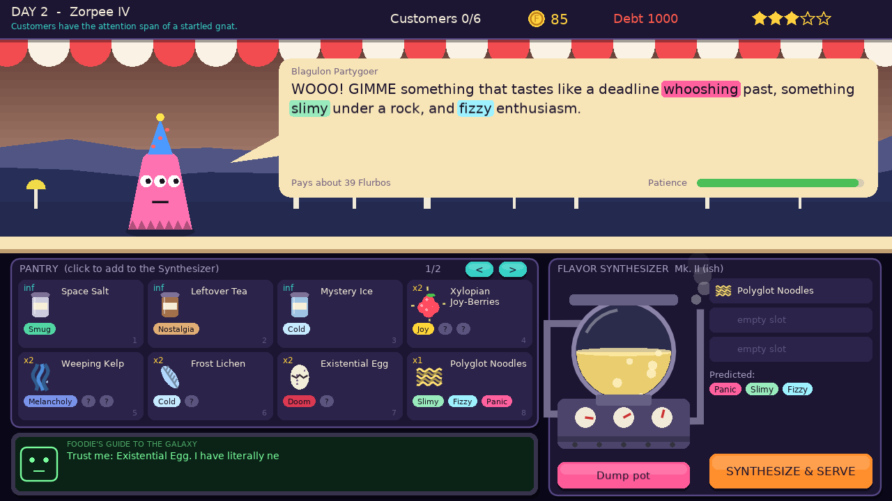
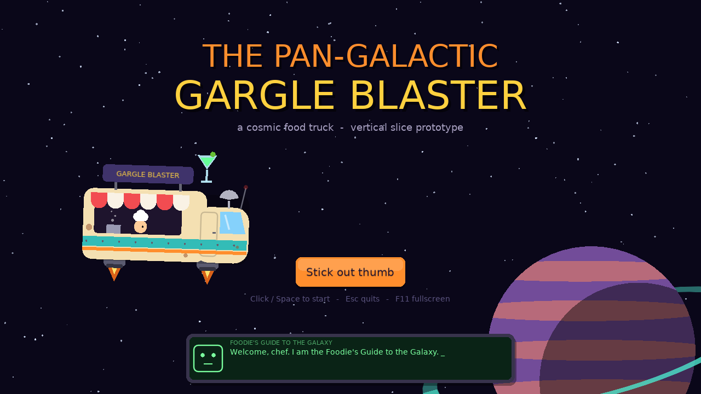
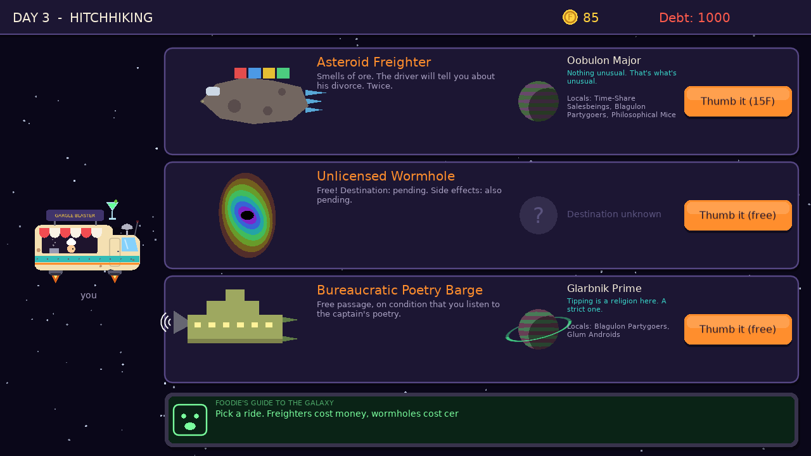
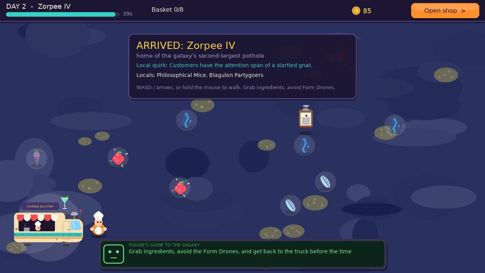
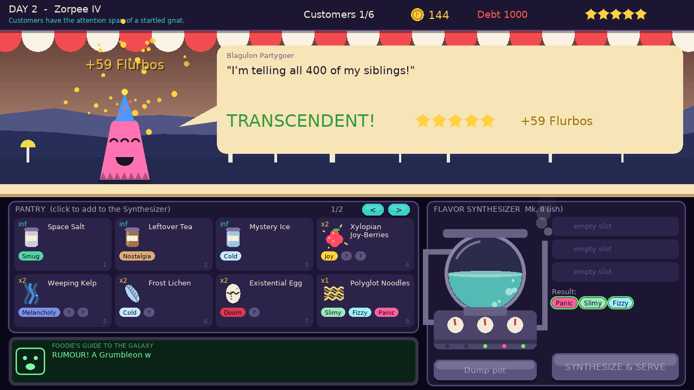
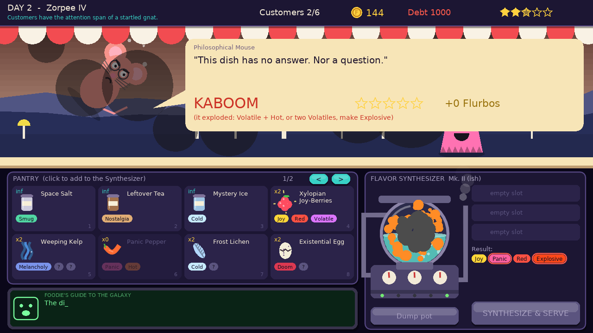
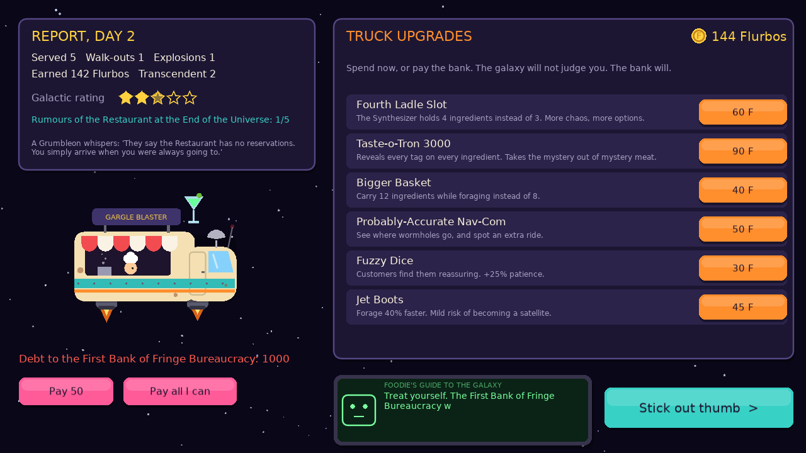

# The Pan-Galactic Gargle Blaster (prototype)

A cosmic food truck game. You hitchhike between planets, forage alien ingredients, and serve
eccentric aliens who order *feelings* instead of dishes ("something that tastes like impending
doom, but with a hint of melancholy").

This is a **vertical slice prototype** made in [LÖVE 11.5](https://love2d.org). It uses **no asset
files**: every visual is drawn with code and every sound is synthesized at startup. The goal is to
find out whether the core loop is fun and whether LÖVE is the right tool for the full game.



## Run it

1. Install LÖVE 11.5 from https://love2d.org
2. From this folder: `love .` (on Windows you can drag the folder onto `love.exe`)

| Command | What it does |
|---|---|
| `love .` | Play |
| `love . --selftest` | Headless tests (no window). Exit code 0 = pass. Includes a bot that plays 3 full days. |
| `love . --snapshots` | Saves a screenshot of every screen to the save folder (`~/.local/share/love/pan-galactic/snapshots` on Linux, `%APPDATA%\LOVE\pan-galactic\snapshots` on Windows) |
| `love . --seed 123` | Repeatable run |

**Controls:** mouse for everything. While foraging: WASD / arrows, or hold the mouse button to
walk toward the cursor. In the shop: number keys add pantry items, Backspace removes the last one,
Enter / Space serves, right-click a pantry card to take one back out. Esc goes to the title screen
(Esc again quits), and F11 toggles fullscreen.

## What's in the slice

The full core loop from your notes, minus the action-cooking mode:

1. **Hitchhike:** three rides pass by. The *Asteroid Freighter* costs 15 Flurbos and shows its
   destination. The *Unlicensed Wormhole* is free, but you don't know where it goes. The
   *Bureaucratic Poetry Barge* is free, but you have to sit through a poem. Every planet is
   procedurally generated, with a name, an epithet, a gameplay quirk, its residents and its
   ingredients.
2. **Forage:** a 40-second top-down scramble. Grab glowing ingredients and dodge **Form Drones**
   (bureaucrats that fine you for loitering). *Volatile* ingredients blow up if you leave them too
   long. Walk back to the truck to open shop.
3. **Serve (Flavor Synthesis):** six customers per shift. Each one describes a feeling, and the
   coloured words are flavour tags. You put up to 3 ingredients in the Synthesizer, and their tags
   add up, with **reactions**:
   - Joy + Doom = Irony
   - Hot + Cold = Lukewarm
   - Melancholy + Nostalgia = Wistful
   - Red + Blue = Purple
   - Smug + Slimy = Bureaucratic
   - Volatile + Hot, or two Volatiles, = **Explosive** (kaboom; the customer is launched into orbit)

   Each customer also hates a tag. Ratings run from Transcendent down to Kaboom.
4. **Discovery:** a newly found ingredient reveals only one of its tags. The rest show as `?`
   until you cook with it, so early dishes are trial and error. The Synthesizer predicts the
   result from what you know so far.
5. **The Guide:** the Foodie's Guide to the Galaxy comments on everything. When an order comes in
   it sometimes hints at an ingredient, and about 30% of those hints are wrong.
6. **Upgrade & repeat:** after each shift, spend Flurbos on 6 truck upgrades or pay down a
   1000-Flurbo debt. A Transcendent dish unlocks a rumour about the Restaurant at the End of the
   Universe. Paying off the debt ends the slice with an invitation.

Every order is generated backwards from a dish you *can* make with your current pantry. That means
every order has a perfect answer, and the tests check this on 400 random orders.

## Screenshots

| | |
|---|---|
|  |  |
|  |  |
|  |  |

## Code map

```
main.lua, conf.lua   entry point -> src/app.lua (LÖVE callbacks, --selftest / --snapshots)
content/             ALL writing and tuning: tags, reactions, ingredients, species, planets,
                     rides (+ poems), upgrades, guide lines and rumours
src/core/            scenes (with fade), viewport (1280x720, letterboxed), rng, sfx (synthesized)
src/game/            rules only, no drawing: flavor (combine + score), orders, run (money,
                     pantry, discovery, upgrades), galaxy (planets, rides)
src/ui/              theme, draw helpers, art (truck, aliens, ingredients, synthesizer, ships),
                     terrain, fx (particles, shake), guide (the CRT narrator)
src/scenes/          title, hitchhike, forage, shop, outfitter
src/dev/             selftest, snapshots
```

To add an ingredient, species or tag, edit the file in `content/`. The self-test checks that
every tag exists and that no ingredient reacts with itself.

## Is LÖVE a good fit? (my verdict from building this)

**Yes, for this game.** It's 2D, UI-heavy, procedural and driven by text, which is where LÖVE is
strongest:

- **Iteration is very fast.** There's no build step and the whole slice is a few thousand lines of
  Lua. Content lives in plain Lua tables, which suits a writing-heavy comedy game well.
- **Procedural art works well.** Planets, aliens and props are all generated, and swapping in
  real sprites later is a local change in `src/ui/art.lua`.
- **Easy to test headless.** The rules have no drawing code, so a bot can play whole days in CI.
- **Shipping:** desktop (Steam on Windows, Mac and Linux) is straightforward. Android and iOS work,
  but they're the fiddliest part of LÖVE, so plan for them later.

Things to plan for in a full project:

- **UI toolkit:** there's no built-in UI. This slice hand-rolls buttons, which is fine for now, but
  a full game wants a small widget layer (your *Per My Last Email* project already has one you
  could reuse).
- **Text:** for localisation and nicer fonts, add a font pipeline (Google Fonts TTFs) and a
  `strings/` table.
- **Saving, settings and audio:** none of these exist yet. Your other project's modules cover them
  too.

## Watch out: names borrowed from Hitchhiker's Guide

"Pan-Galactic Gargle Blaster", "Restaurant at the End of the Universe" and "Triganic Pu" (from your notes) all come
from Douglas Adams' books. That's fine for a private prototype. For anything you sell, rename them
(and the Guide's title) to original names that keep the same spirit. The poems, species and jokes
in this slice are already original.

## Ideas for the next slice

- Absurd Assembly Line: a timed, *Cook, Serve, Delicious!*-style mode for rush hours.
- Per-species reputation that unlocks lore and new ingredients.
- Story events between planets, plus the debt collector.
- Ingredient spoilage, and recipes you can save.
- A proper ending: actually reaching the Restaurant.
