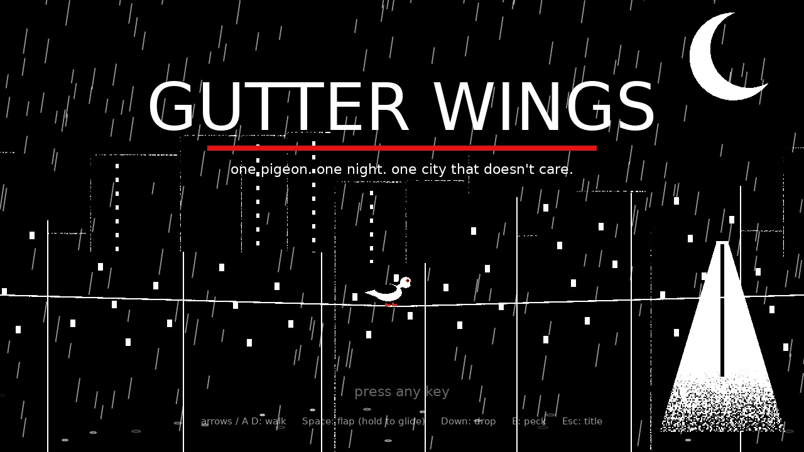
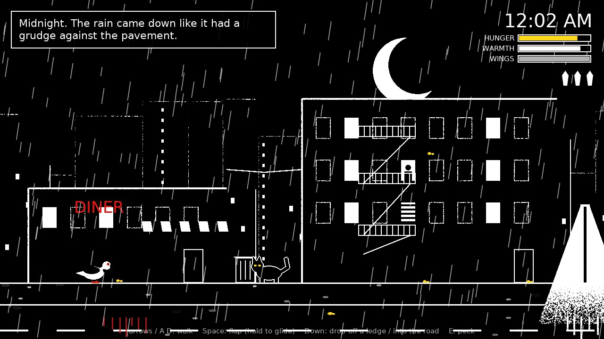
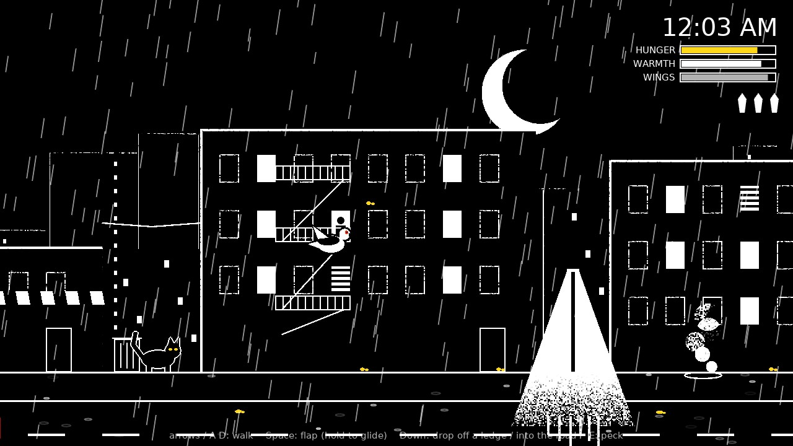
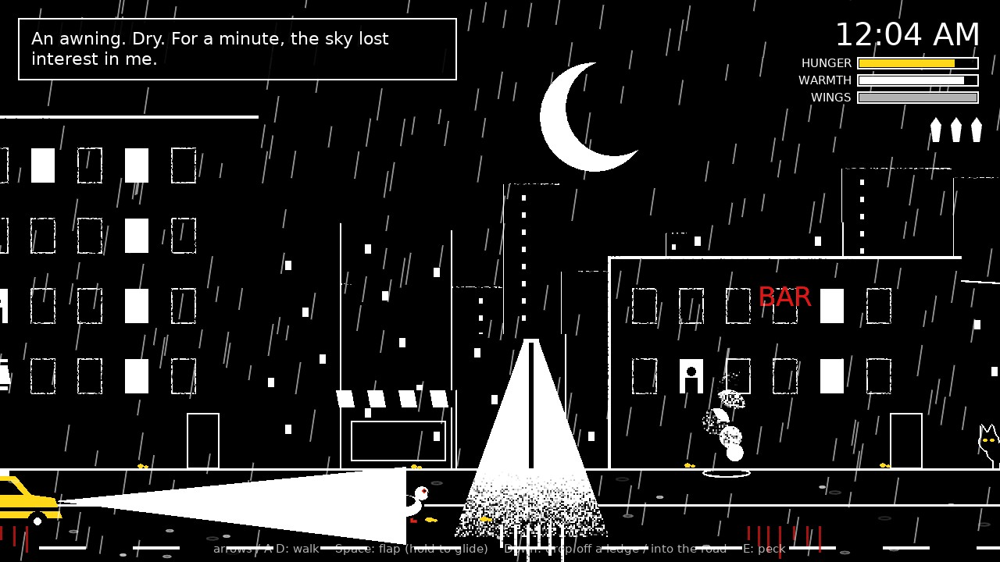
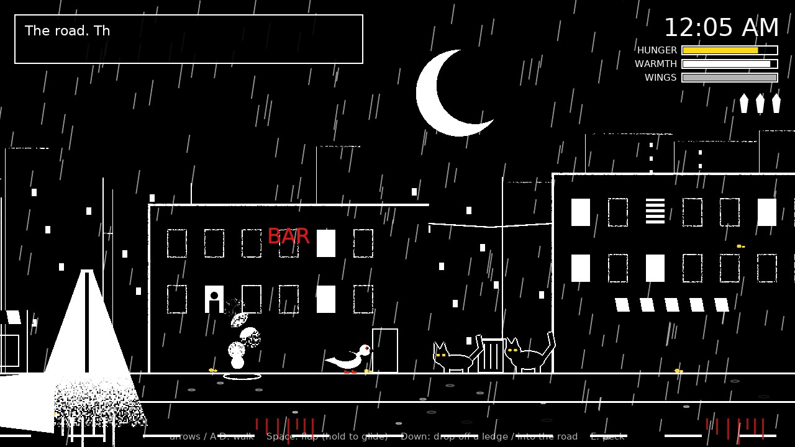
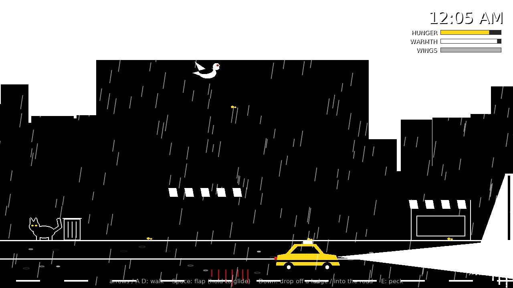
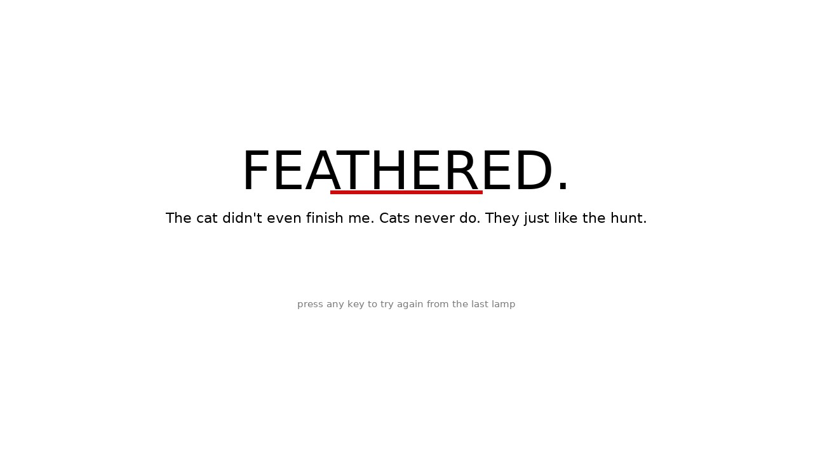
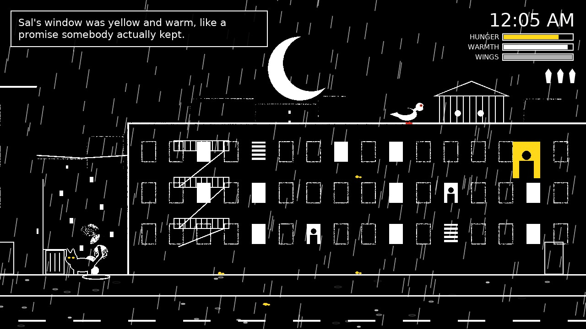

# Gutter Wings (prototype)

A noir survival game about a pigeon. It's midnight, it's raining, and Gus has to get
across town to Old Sal's rooftop coop before the sun comes up. The city doesn't care.

The look is high-contrast comic noir: pure black and white with hard light, white rain,
and only two colours allowed to survive (red neon and yellow). It's an original game and
story, built in [LÖVE 11.5](https://love2d.org) with **no asset files**. The art is drawn
in code and the sounds are synthesized at startup. It grew out of the *Noir* style in
[`../style-showcase`](../style-showcase).



## Run it

From the repository root:

```bash
love pigeon-noir
```

| Command | What it does |
|---|---|
| `love pigeon-noir` | Play |
| `love pigeon-noir --mute` | Play without sound |
| `love pigeon-noir --selftest` | A bot stages every rule and hazard and checks it (30 checks). Exit code 0 = pass. |
| `love pigeon-noir --snapshots` | Saves screenshots of key moments to the save folder (`~/.local/share/love/gutter-wings/snapshots` on Linux) |

**Controls:** arrows or A/D to walk, **Space** (or W/Up) to flap, *hold* it to glide,
**Down** (or S) to drop off a ledge or hop off the curb into the road, **E** (or J/Enter) to
peck. Tab skips the narration, Esc goes back to the title, F11 toggles fullscreen.

## How to survive

- **Get to Sal's.** His building is at the far east end of the street. Land on his roof by
  the coop to make it through the night. Dawn comes at 6:00 AM (about 6 real minutes).
- **Hunger** drains all night. Peck the yellow crumbs. The fat ones are down in the road.
  Peck a trash can to knock it over, and the diner cook throws out fries every so often.
- **Warmth** drains in the rain. Get under an awning or the bus shelter, or stand in the
  steam from a gutter vent.
- **Wings** tire as you flap. Rest on a ledge, a fire escape, a wire or a rooftop.
- **Cats** wait in the alleys. If you're on the ground nearby, they crouch (that's your
  warning) and pounce. They can't reach you up on a wire or a ledge.
- **Taxis** own the road. Their headlights reach far ahead of them, and they honk when
  you're in the lane. Get back up on the curb (flap).
- **Feathers** are your lives: 3 of them. Running out of food or warmth costs feathers too.
- **Street lamps:** perch on one and Gus remembers the corner. If you die, you come back
  there.

| | |
|---|---|
|  |  |
|  |  |
|  |  |
|  |  |

## How the look works

- **Author in grey, print in two tones.** The whole city is drawn in greys plus two spot
  colours into a canvas. A shader then keeps strongly saturated pixels (red neon, yellow
  crumbs, cat eyes, the taxi) and crushes everything else to pure black or white at 50%
  brightness. A little moving noise in the threshold makes edges gritty, like ink on
  newsprint.
- **Light is a shape.** A street lamp's cone is a gradient that becomes a hard white
  wedge, with a crumbling lower edge where the gradient crosses the threshold. Anything
  dark in front of it becomes a silhouette.
- **Outlines decide what reads.** Gus is white with a heavy black outline, so he shows up on
  both black streets and white light. Cats are black with a white rim.
- **Lightning:** every so often the sky goes white, the city turns into flat black
  silhouettes, and sometimes a siren wails.
- **Hits:** the frame inverts for an instant, like a panel flash in a comic.
- **Wet streets:** lamps and neon smear into vertical streaks on the asphalt.

## Code map

```
main.lua          title screen, letterboxed 1280x720 canvas, --selftest / --snapshots
conf.lua          window; audio off for tests, screenshots and --mute
src/game.lua      survival rules, cats, taxis, meters, checkpoints, narration, HUD, death/win
src/pigeon.lua    Gus: walk, flap (stamina), glide, perch, drop through, peck; his drawing
src/render.lua    drawing the city in greys + spot colour, and the two-tone shader
src/city.lua      the street layout: buildings, perches, shelters, vents, food, cats
src/content.lua   ALL the writing: narration, death lines, the ending
src/sfx.lua       synthesized rain, flaps, coo, horn, hiss, siren, sting
src/selftest.lua  the bot that checks every rule
```

To rewrite the narration, edit `src/content.lua`. To move buildings, cats or crumbs around,
edit `src/city.lua`. The meter rates are near the top of `game:update` in `src/game.lua`.

## Ideas for next steps

- A rival pigeon gang that steals your crumbs, and a crow informant who sells tips.
- Subway grates (warm, but trains rumble), pigeon-spikes on some ledges.
- Short "case files": rescue a chick from a gutter, return a lost ring, find Sal's hat.
- Comic panel transitions between districts, with full-page splash art at the end.
- A rooftop chase with a hawk at dawn.
