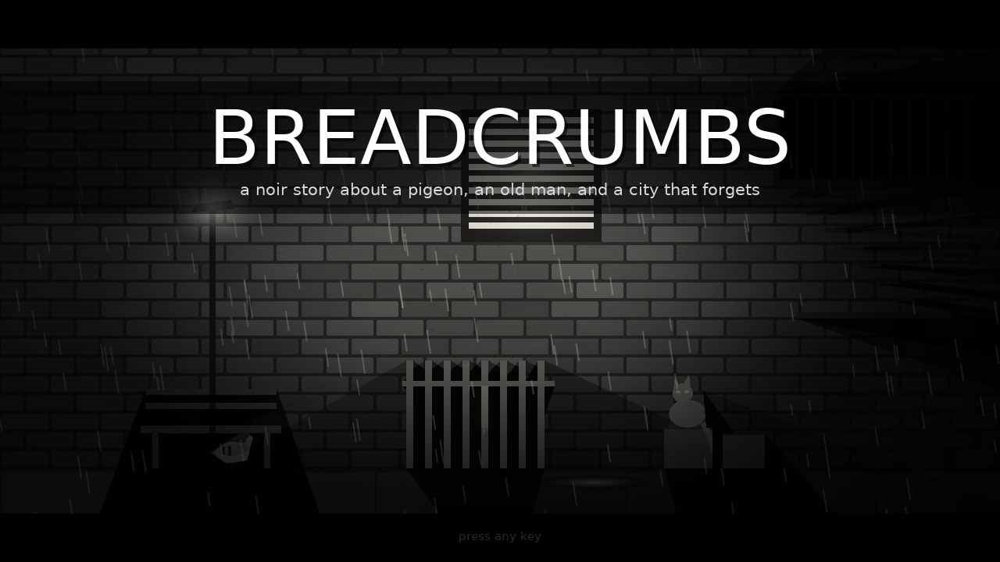
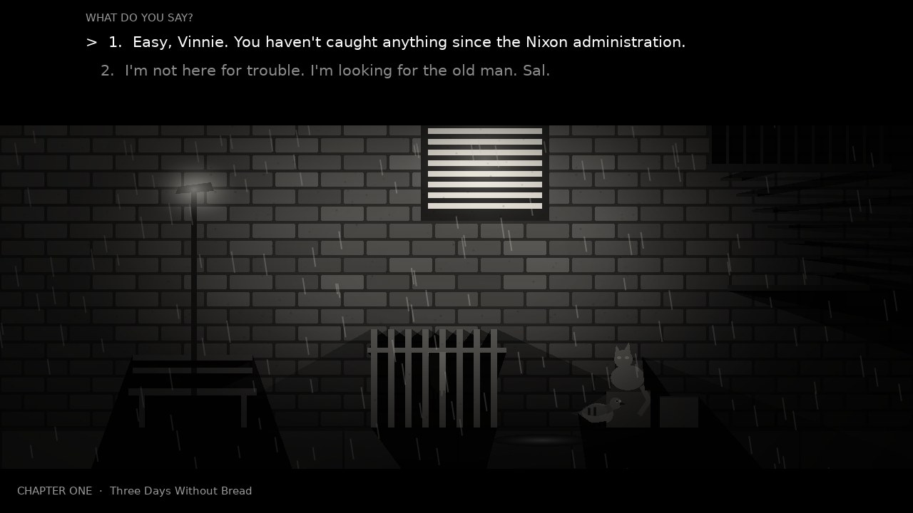
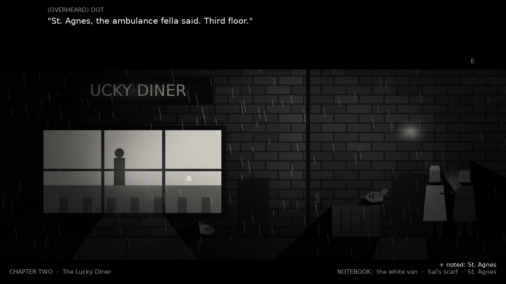
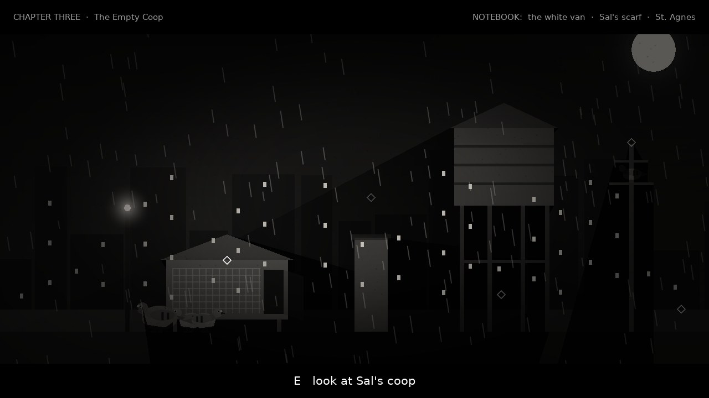
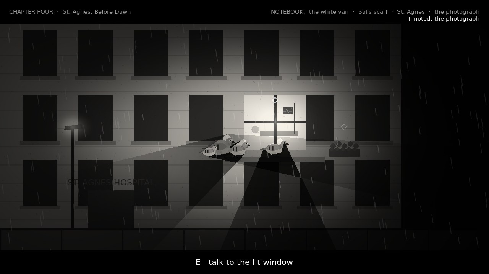
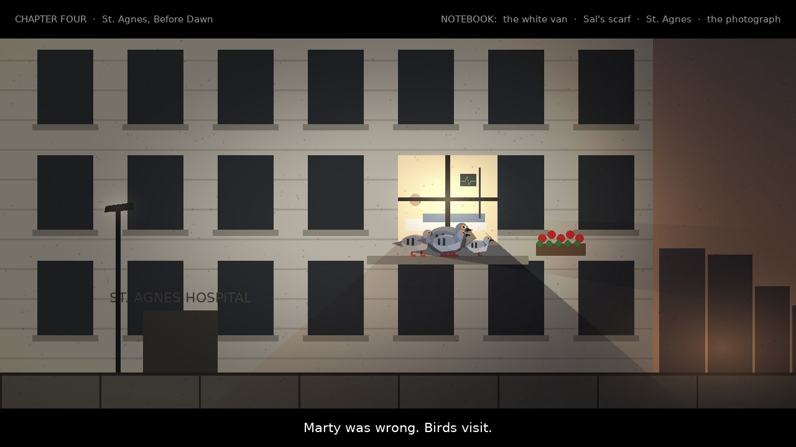

# BREADCRUMBS (prototype)

*A noir story about a pigeon, an old man, and a city that forgets.*

Old Sal fed the birds on Mercer Street every morning for nine years. Then, three days ago,
he stopped coming. Gus, a city pigeon, goes looking for him.

A short story game in four chapters, made in [LÖVE 11.5](https://love2d.org) with **no
asset files**. The look matches the *Noir* scene in [`../style-showcase`](../style-showcase).
Every scene is painted in colour, lit with real ray-cast shadows, and graded to black and
white with film grain, a vignette and cinematic letterbox bars. In the last chapter, at
dawn, the colour slowly comes back.



## Run it

From the repository root:

```bash
love pigeon-story
```

| Command | What it does |
|---|---|
| `love pigeon-story` | Play (about 15 minutes) |
| `love pigeon-story --mute` | Play without sound |
| `love pigeon-story --selftest` | A bot plays the whole story twice (all tender choices, then all hard-boiled ones) and checks every step: 38 checks. Exit code 0 = pass. |
| `love pigeon-story --snapshots` | Saves screenshots of key moments to the save folder (`~/.local/share/love/breadcrumbs/snapshots` on Linux) |

**Controls:** arrows (or A/D) to walk, **Up** to flutter onto a perch, **Down** to hop down,
**E** (or Space/Enter) to look, talk and continue. In a conversation, pick an answer with
Up/Down and E, or press 1/2. Esc goes back to the title, F11 toggles fullscreen.

## How it plays

- **Walk, look, listen.** Each chapter is one staged scene. Small diamonds mark the things
  you can look at or talk to. Walk up to one and press E.
- **Animals talk, humans don't.** Gus can talk to cats and other pigeons. People can't
  understand pigeons, but pigeons understand people just fine, so some of the best clues
  come from *eavesdropping*. Perch on the dumpster behind the diner and listen in on the
  cook's smoke break.
- **The notebook.** Clues collect in the top bar. Each chapter's exit opens once you've
  learned what you need ("Not yet. Somebody around here saw something.").
- **Choices.** In conversations you choose what Gus says: tender or hard-boiled. Share your
  crust with a hungry chick, or teach him a lesson. Coax the flock along with kindness or
  with grit. No answer is wrong; the choices shape who Gus becomes and which epilogue
  you get.

### The four chapters

| | |
|---|---|
| **1. Three Days Without Bread.** The alley and Sal's empty bench. Vinnie the old tomcat saw something. |  |
| **2. The Lucky Diner.** Sal's third booth sits empty. A hungry chick, and two humans on a smoke break who know where Sal went. |  |
| **3. The Empty Coop.** Sal's rooftop coop, and a scattered flock that needs persuading. |  |
| **4. St. Agnes, Before Dawn.** One lit window on the third floor. |  |



## How the look works

Same recipe as the showcase's Noir scene:

1. **Paint in colour.** Red bricks, a warm lamp, the diner's yellow window, green and purple
   on the pigeons' necks, red geraniums.
2. **Real shadows.** `lighter` casts rays from each light past every occluder: bench slats,
   fence pickets, people, the water tower and the pigeons themselves. The resulting light map
   is multiplied over the scene, so the fence throws striped shadows and the birds on the
   ledge throw long ones down the hospital wall.
3. **Things that glow** (neon, lit windows, cigarette embers, the moon) are added after the
   light map, so darkness never touches them.
4. **Grade it.** A `moonshine` chain desaturates to black and white, adds film grain and a
   vignette.
5. **Frame it.** Letterbox bars hold the chapter title, the notebook, the prompts and the
   typewriter dialogue. Dialogue opens in the top bar, so it never covers the characters.
6. **The payoff:** in the finale the desaturation eases from 100% down to about 20% while
   the sky warms. The colour that was "there all along" comes back with the dawn.

## Code map

```
main.lua          title screen (the alley, graded), letterboxed canvas, --selftest / --snapshots
conf.lua          window; audio off for tests, screenshots and --mute
src/story.lua     THE STORY: chapters, hotspots, dialogue trees, choices, clues, epilogues
src/game.lua      story engine: hotspots, dialogue runner, notebook, flock, light map, grade, UI
src/scenes.lua    the four scenes, painted in colour: lights, occluders, props, glows
src/pigeon.lua    Gus (walk / perch / flutter) and the painter for every bird
src/sfx.lua       synthesized rain, flutters, coos, typewriter, piano phrase, dawn chord
src/selftest.lua  the bot that plays the story both ways
lib/              moonshine (film grade) and lighter (shadows), from the style showcase
```

### Writing your own chapters

Everything that happens is data in `src/story.lua`. A chapter lists its perches and
**hotspots**. A hotspot plays a dialogue **node**. A node is a list of lines, optionally
ending in **choices**. Nodes can `give` a clue, set a `flag`, nudge Gus `kind` or `grit`,
make a pigeon `join` the flock, or start the `ending`. A hotspot can `require` clues or flags,
or need Gus to be on a particular `perch`. To add a scene you also paint it in
`src/scenes.lua`: a function that returns its lights, occluders, and `back` / `emissive`
drawing functions.

## Ideas for next steps

- Portraits: a close-up "panel" of whoever is talking, painted the same way.
- A short chapter in the pouring rain on the river bridge, where Gus crosses paths with a crow.
- More consequences: Pip shows up in chapter four if you fed him; Vinnie is waiting
  at the end if you were polite.
- Music: a slow, synthesized piano loop under each chapter.
- A "colour moments" mechanic: tiny spots of colour appear wherever Gus does something kind.
