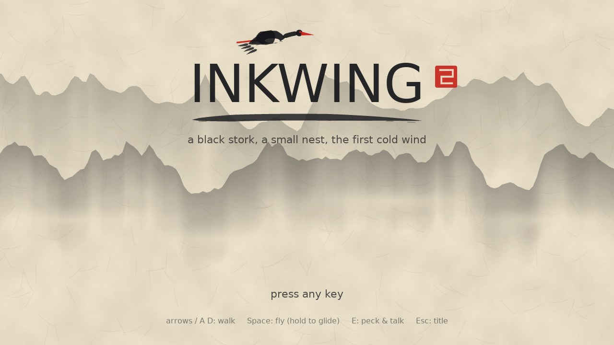
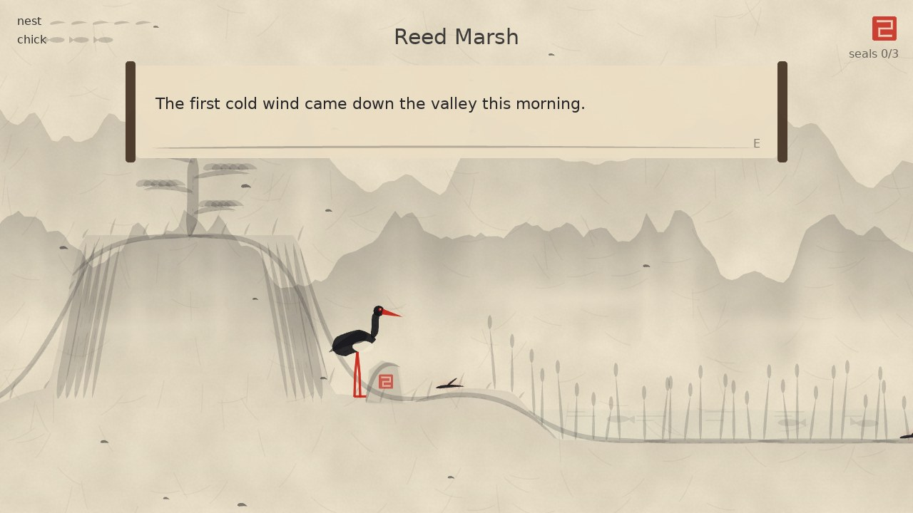
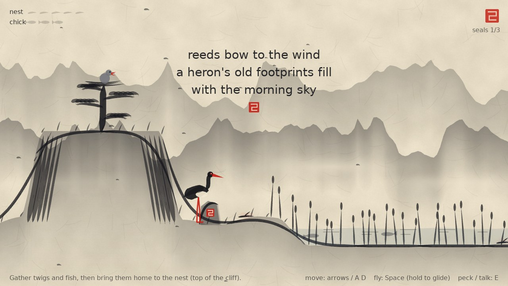
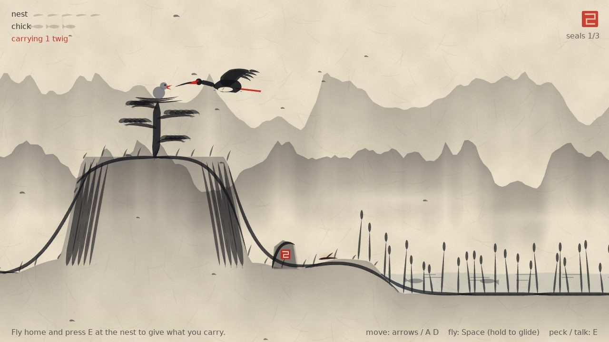
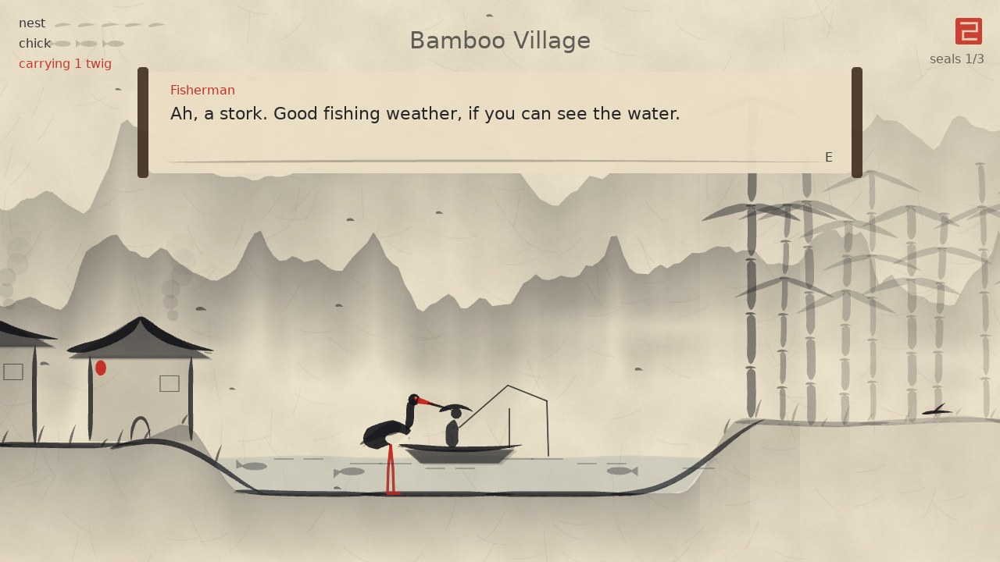
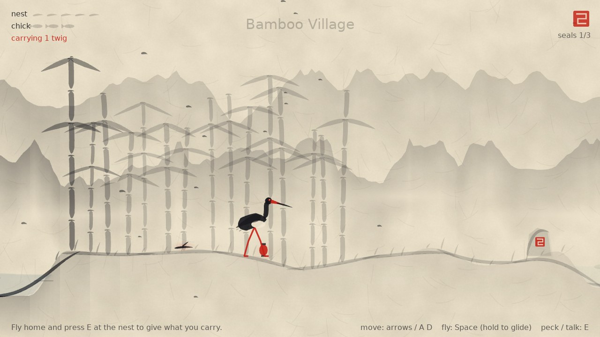
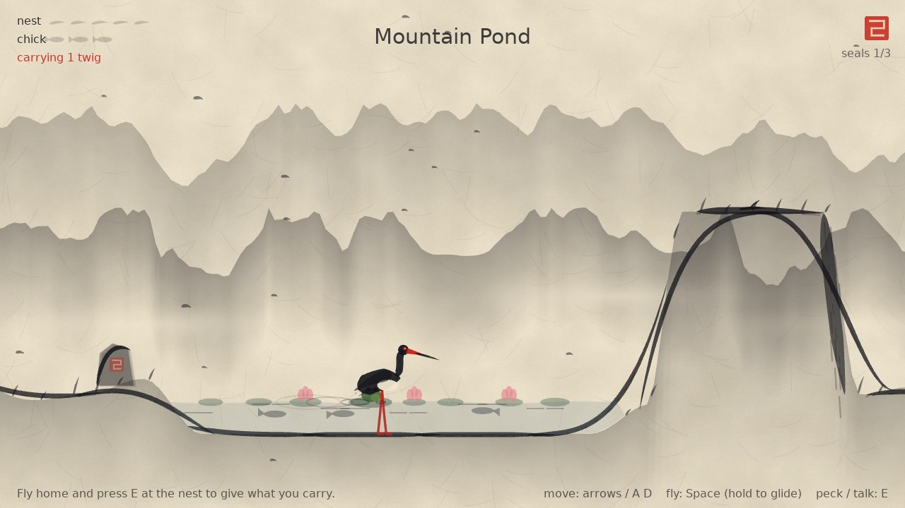
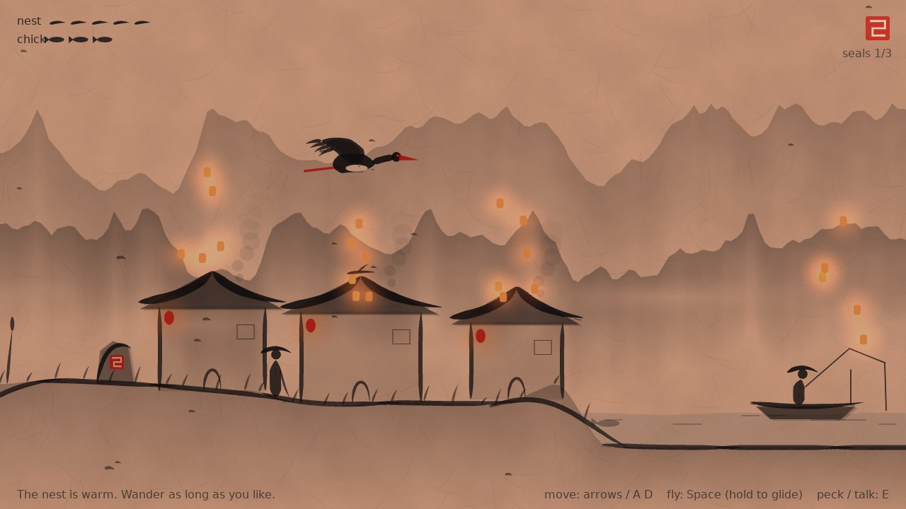

# Inkwing (prototype)

A cozy, light adventure in ink-wash (sumi-e) style. You are a **black stork**. The first
cold wind has come down the valley: mend your nest and feed your chick before winter.

Made in [LÖVE 11.5](https://love2d.org) with **no asset files**. The art is brush strokes
generated in code, and the sounds are plucked strings synthesized at startup. It grew out of
the *Ink Wash* style in [`../style-showcase`](../style-showcase).



## Run it

From the repository root:

```bash
love stork-game
```

| Command | What it does |
|---|---|
| `love stork-game` | Play |
| `love stork-game --selftest` | A bot plays the whole game (twigs, fish, lantern quest, a seal stone, the ending) and checks each step. Exit code 0 = pass. |
| `love stork-game --mute` | Play without sound |
| `love stork-game --snapshots` | Saves screenshots of key moments to the save folder (`~/.local/share/love/inkwing/snapshots` on Linux) |

**Controls:** arrows or A/D to walk, **Space** (or W/Up) to flap, *hold* it to glide, **E**
(or J/Down/Enter) to peck and talk. Esc goes back to the title, F11 toggles fullscreen.

## What you do

- **Mend the nest.** Find 5 twigs around the valley and peck them up. Some sit on the ground;
  one is on a village roof and one on a high ledge, so you'll have to fly. Bring them to the
  nest at the top of the cliff and press E.
- **Feed your chick.** Wade into the shallows (storks wade!) and peck when a fish's shadow
  passes your beak. 3 fish fill a small belly.
- **The fisherman's lantern.** He lost it in the bamboo grove. Bring it back and he'll give you
  his best fish.
- **Seal stones.** The valley starts as a faint sketch. Read the red seal stone in each region
  and a haiku appears while ink spreads out and paints that part of the world in.
- **The ending.** When the nest is mended and the chick fed, dusk falls and the village sends
  up lanterns. You can keep wandering.

There is no failing, no timer and no damage.

| | |
|---|---|
|  |  |
|  |  |
|  |  |



## Code map

```
main.lua          title screen, letterboxed 1280x720 canvas, --selftest / --snapshots
conf.lua          window; audio off for tests and screenshots
src/game.lua      play state: input, pecking/talking, quests, ink reveal, camera, HUD, dialogue
src/stork.lua     the black stork: walk, wade, flap, glide, peck; drawn with brush strokes
src/scenery.lua   painting the valley: mountains, terrain, cliff + nest, reeds, village,
                  boat, bamboo, pond, waterfall, water surface
src/world.lua     terrain shape, shallow water, regions, where every item and NPC is
src/ink.lua       the brush toolkit: pressure strokes, washes, mountain meshes, paper, seal
src/content.lua   ALL the writing: intro, hints, haiku, dialogue, ending
src/sfx.lua       synthesized sounds (Karplus-Strong plucks on a pentatonic scale)
src/selftest.lua  the bot that plays the game
```

To change what characters say, or add a haiku, edit `src/content.lua`. To move things around
the valley, edit `world.build()` in `src/world.lua`.

## How the look works

- **Brush strokes:** a Bezier curve becomes a triangle strip whose width follows "pen pressure"
  (thin start, full middle, flicked-off end), plus a few broken lines for dry-brush streaks.
  The stork, the pine, the bamboo and the roofs are all made this way.
- **Washes:** mountains are meshes that go from dark ink at the ridge to clear lower down, so
  each range dissolves into the paper. Mist is simply unpainted paper.
- **Ink reveal:** each part of the world asks "how inked am I?" Before its seal stone is read
  the answer is 25% (a faint sketch). Afterwards it rises to 100%, spreading outward from the
  stone. Meshes are drawn in narrow vertical slices so each slice can have its own ink level.
- **Water:** the surface is drawn *after* the stork, so wading legs look submerged.
- **Dusk:** a multiply pass warms the whole painting, then lanterns glow on top.

## Ideas for next steps

- More of the valley: a tea house, a temple gate, a winter region with snow.
- Seasons that change the palette (autumn ochre washes, winter blue-grey).
- Other animals with small favours to ask (a crane, an otter, a lost duckling).
- A photo or brush mode that saves the current view as a painting.
- Gamepad support (LÖVE has it built in) and gentle ambient music from the same plucks.
