# LÖVE Style Showcase: art with code only

Seventeen art styles and 51 scenes in [LÖVE 11.5](https://love2d.org), and **not one image
file**. Every sprite, texture, font, gradient and effect is generated by Lua code (and some
inline GLSL shaders) when the program starts. It uses 20 libraries from
[awesome-love2d](https://github.com/love2d-community/awesome-love2d).

It's a reference for picking a look for a game and for seeing how each look is built. Each
scene is one self-contained file in `scenes/`, commented from top to bottom like a recipe.
Every style has three scenes, to show how much range one look can have. The gallery
thumbnails take turns, so each style shows all three of its scenes; click a thumbnail to
open the scene it is showing.


The 24 scenes added in the second pass (two per style for the twelve styles that had one):

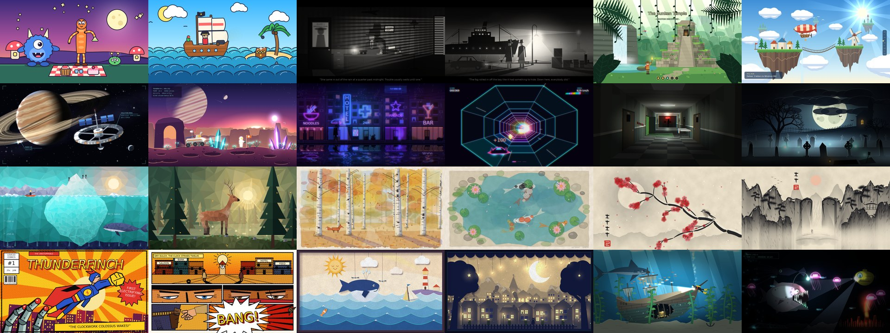

## Run it

From the repository root (the folder above this one):

```bash
love style-showcase
```

| Command | What it does |
|---|---|
| `love style-showcase` | Opens the gallery. Click a thumbnail. |
| `love style-showcase --scene pixel_dungeon` | Starts on one scene (use its file name in `scenes/`). |
| `love style-showcase --tour 8` | Slideshow: moves to the next scene every 8 seconds. |
| `love style-showcase --snapshots` | Saves a PNG of every scene, then quits. |
| `love style-showcase --selftest` | Loads, clicks, presses keys in and draws every scene, then quits. Exit code 0 means it passed. |
| add `--only <id>` | Loads only one scene. Faster while you tweak it. |

**Controls:** Left/Right arrows switch style, Up/Down switch between the scenes of a style (or
click the yellow scene pill), **I** opens the *How it's made* panel (techniques, libraries,
matching genres), Esc goes back to the gallery, F11 toggles fullscreen and F12 saves a
screenshot. Some scenes respond to the mouse or keys; the info panel says how.


> `love .` in the repo root still runs the Pan-Galactic game; this folder is separate. If you
> zip the repo root into a `.love` file for the game, leave `style-showcase/` out.

## The styles

| | Style / scene | How it's drawn | Libraries | Good for |
|---|---|---|---|---|
|  | **Cartoon** 1/3<br>Sunny Meadow | Every shape drawn twice (outline, then fill). Squash & stretch on a single ellipse. Comic "BOING!" burst. | flux, hump.timer, draft | Platformers, kids' and casual games, pet sims |
| 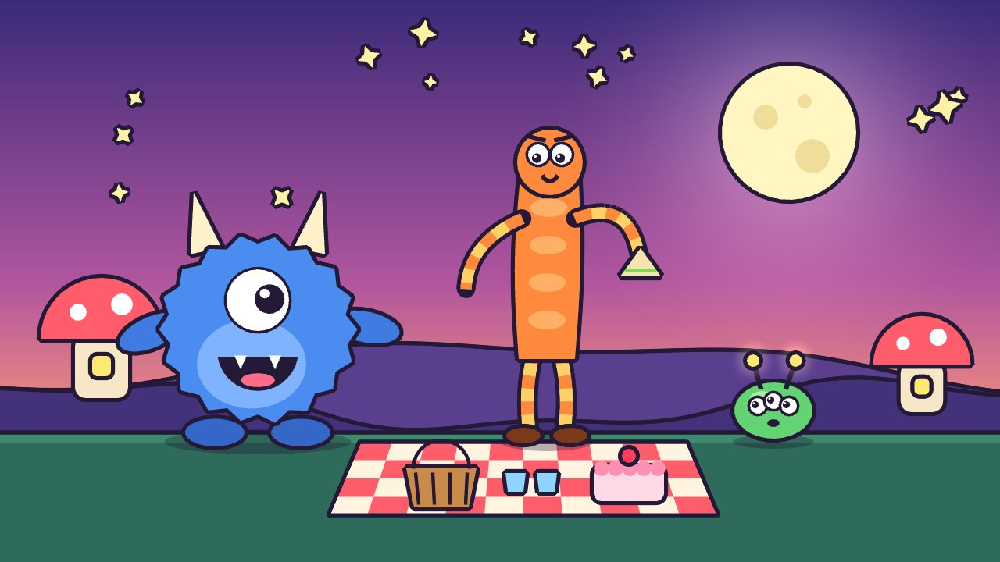 | **Cartoon** 2/3<br>Monster Picnic | Three monsters built from the same outline-then-fill helper: a fuzzy cyclops, a striped noodle, a three-eyed blob. Hops and blinks on tweens and timers. **Click** near one to make it jump and shout. | flux, hump.timer, draft | Creature collectors, party games, kids' games |
|  | **Cartoon** 3/3<br>Pirate Cove | Scalloped wave rows with the ship rocking between them, a treasure island, a shark fin and a cannon that fires an arc with a "SPLOOSH!". **Click** to fire. | flux, draft | Casual action, artillery games, storybooks |
|  | **Pixel Art** 1/3<br>Moonlit Village | Real 320×180 canvas with a 16-colour palette, scaled ×4. Sprites and a 3×5 pixel font are strings in the code. Bayer-dithered sky and lamp glow. | maid64, Bresenham, tick | Retro platformers, RPGs, jams |
|  | **Pixel Art** 2/3<br>Torchlit Dungeon | ASCII level map. Field of view from Bresenham rays. Torch and lantern light quantised into 4 dithered levels, so no new colours appear. The hero paths with BFS. | Bresenham | Roguelikes, dungeon crawlers, stealth |
|  | **Pixel Art** 3/3<br>4-Shade Handheld | 160×144 screen with only 4 shades. LCD ghosting, a visible pixel grid and a drawn handheld bezel. Jump physics, spinning coins. | (none) | Handheld-style platformers, demakes |
|  | **Noir (B&W)** 1/3<br>Rain on Fifth Street | Drawn in colour, then graded to black & white in post (press **C** to compare). Ray-cast shadows, rain, cigarette smoke, letterbox. | lighter, moonshine | Detective / mystery, stealth, narrative |
| 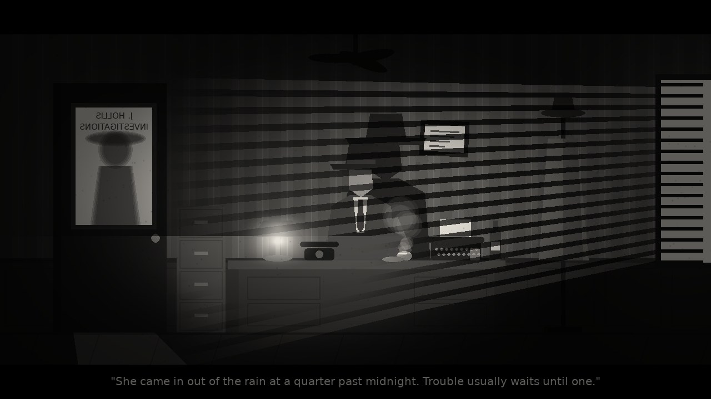 | **Noir (B&W)** 2/3<br>The Private Eye's Office | Venetian-blind light painted straight into a light map as a fan of fading stripes that fall across the room and the detective. A wall shadow made by scaling his outline away from the lamp. Frosted-glass door with mirrored lettering. **C** shows the colour version. | moonshine | Detective adventures, dialogue games, case hubs |
| 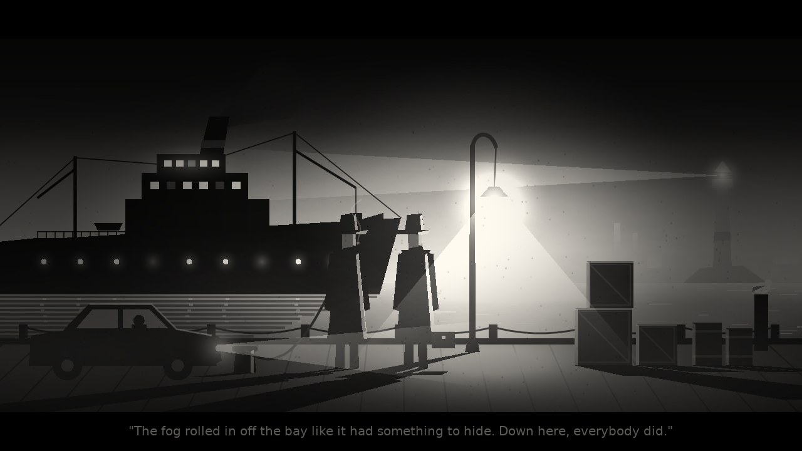 | **Noir (B&W)** 3/3<br>Fog on Pier 19 | Backlight: black silhouettes against glowing fog. A swinging dock lamp whose shadows are *projected* onto the deck (every corner pushed away from the bulb), rim light on the lamp side, a lighthouse beam, a freighter. | moonshine | Crime stories, dockside stealth, cutscenes |
|  | **Romantic** 1/3<br>Blossom Hill at Dusk | Sunset gradient interpolated in HSLuv, a recursively grown cherry tree, a heartbeat on chained tweens, petal particles, bloom. | hsluv, moonshine, flux | Visual novels, dating sims |
|  | **Romantic** 2/3<br>Rainy Café Window | The city outside is blurred once (depth of field). Bokeh discs. Raindrops act as tiny lenses that show the street upside down. Candlelight and steam. | moonshine, hsluv | Cosy narrative, café sims, lo-fi ambient |
|  | **Romantic** 3/3<br>Lantern Lake | Hundreds of sky lanterns. The upper half is mirrored into the lake in rippling strips. New lanterns float up from the boat. | flux, hsluv, moonshine | Festival events, finales, relaxing toys |
|  | **Adventure** 1/3<br>The Road to Highspire | 5 parallax layers with atmospheric perspective. An infinite world placed by hashing. Procedural walk cycle. Typewriter RPG dialogue with `[bounce]`/`[shake]` tags. | hump.camera, love-parallax, SYSL-Text, hump.timer | Action-adventure, side-scrolling RPGs |
| 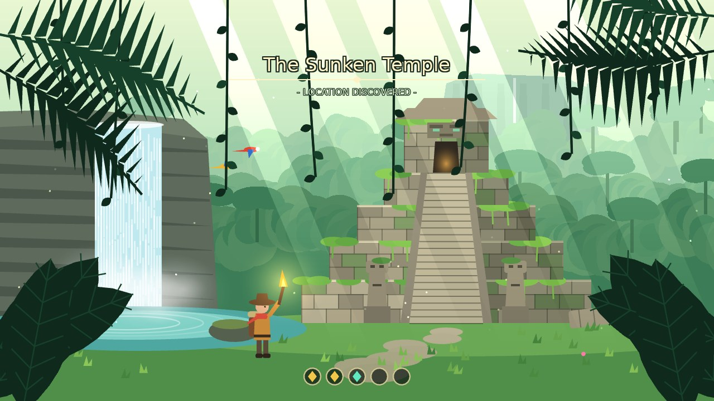 | **Adventure** 2/3<br>The Sunken Temple | Theatre-set depth: hazy canopy layers, a stepped temple whose masonry comes from loops and a hash, a waterfall with mist, light shafts, swaying vines and dark framing leaves. A "location discovered" banner on tweens. | flux, hump.timer | Exploration, treasure hunting, puzzle temples |
| 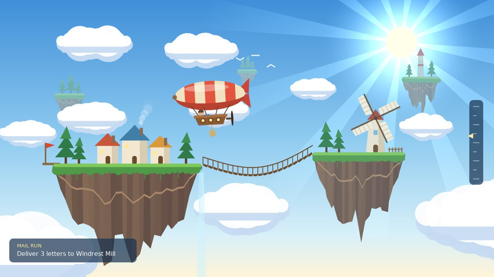 | **Adventure** 3/3<br>The Floating Isles | One island recipe (jagged tapering rock + grass cap + props) at several scales. Depth-sorted clouds, a rope bridge, a windmill, and a mail airship that follows the **mouse** in front of and behind things. | deep, brinevector | Flight and delivery games, JRPG world maps |
|  | **Realistic** 1/3<br>Alpine Lake, Golden Hour | Sky, cloud, rock/snow and water shaders. Hazy mountain layers. The lake is the scene mirrored through a ripple + Fresnel shader. God rays from an occlusion mask. | moonshine | Exploration, nature, premium menus |
|  | **Realistic** 2/3<br>Northern Lights | Aurora shader: a moving hem line, light fading upward, stretched-noise rays, colour shifting green to violet. Snowy pines, a warm cabin, a frozen lake, snowfall. | moonshine | Cold-climate survival, quiet adventures |
|  | **Realistic** 3/3<br>Desert Dunes | A sand shader with a lit face, a shadowed slip face and wind ripples. Slanted crest bands. A heat-shimmer post shader, a lens flare, a camel caravan. | moonshine | Open-world, rally, desert adventures |
|  | **Space Sci-Fi** 1/3<br>Orbit of Kepler-Vire | Rotating planet shader: textures from 3D noise, lighting, clouds, city lights at night, atmosphere. Domain-warped nebula. The ship is an **inline SVG string**. | lovector, moonshine | Shooters, 4X, space sims, sci-fi UI |
| 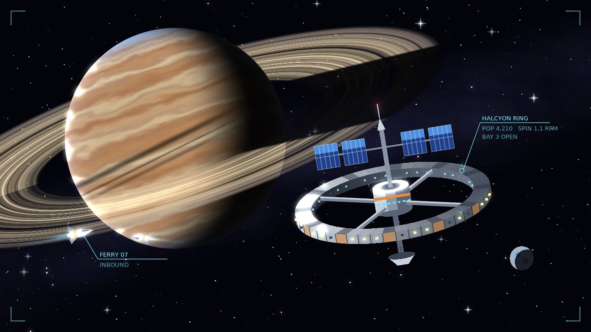 | **Space Sci-Fi** 2/3<br>Halcyon Ring | A gas giant and its rings in one shader: noise-warped bands, a storm, ring lanes from 1-D noise, the planet's shadow on the rings and the rings' shadow on the planet. A rotating wheel station built from squashed circles. HUD callouts. | moonshine | Station sims, trading and docking, sci-fi menus |
| 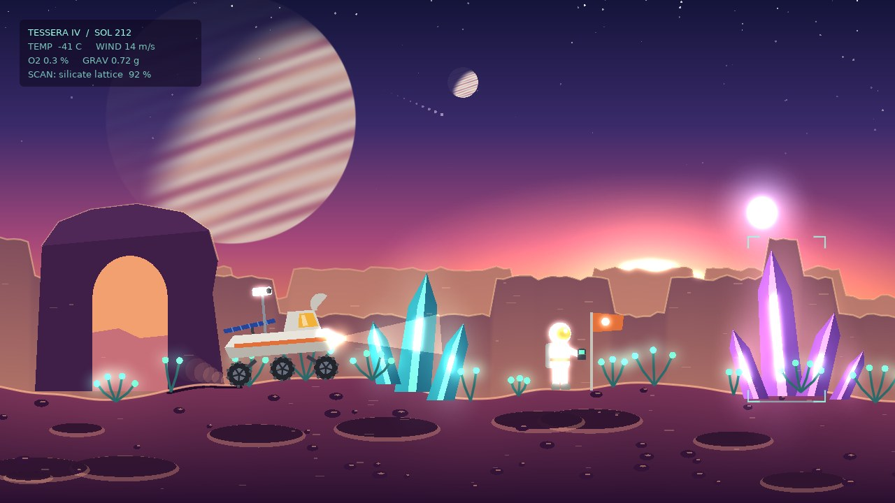 | **Space Sci-Fi** 3/3<br>Dawn on Tessera IV | Two suns and a giant in the sky (a shader whose alpha is its brightness). Terrain as a height function shared by the ground mesh and a six-wheeled rover. Faceted crystals, glowing plants, a scanner HUD. | moonshine | Planetary exploration, rover and mining sims |
|  | **Neon Synthwave** 1/3<br>Midnight Drive | Every line drawn twice (wide and dim, then thin and bright) plus bloom. A hand-projected 3D grid. A striped sun. A chrome text shader. CRT, scanlines and chromatic aberration. A pulse on the beat. | moonshine, shack | Arcade racers, rhythm, vector shooters |
| 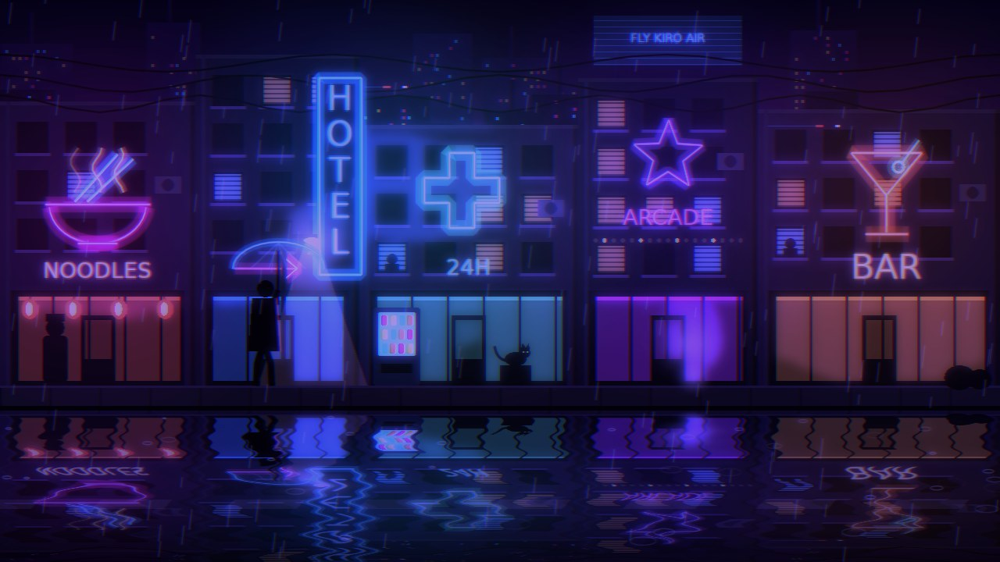 | **Neon Synthwave** 2/3<br>Rain on Kiro Street | Neon tubes drawn as halo + colour + white core. The whole street is rendered to a canvas and drawn again upside-down through a ripple shader: a wet road for free. Flickering signs, steam, rain, an umbrella walker. | moonshine | Cyberpunk adventures, beat 'em ups, shop hubs |
| 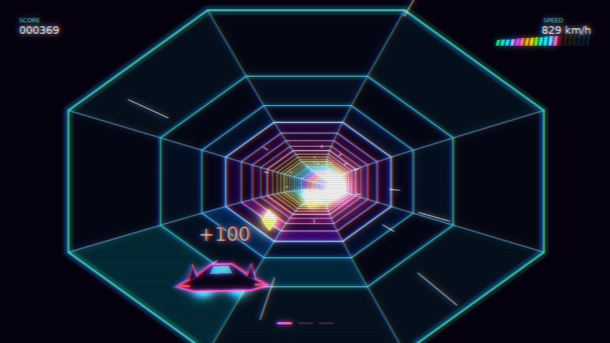 | **Neon Synthwave** 3/3<br>Hyperloop | A wireframe tunnel projected by hand (`screen = centre + world × focal / z`), bending with depth, coloured per ring through HSLuv. Pickups, speed lines, a ship that follows the **mouse**. | hsluv, moonshine, shack | Tunnel runners, rhythm racers, bonus stages |
|  | **Horror** 1/3<br>Don't Go Into the Woods | Shadow-casting flashlight cone. Mist that only shows inside the beam. Eyes that hide from the light. Lightning reveals with screen shake. | lighter, moonshine, shack | Survival horror, stealth, fog-of-war games |
| 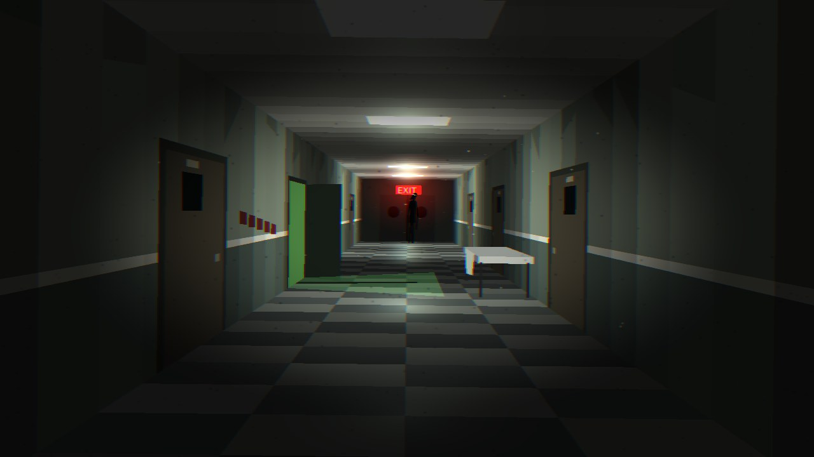 | **Horror** 2/3<br>Ward C, Night Shift | One-point perspective corridor cut into z-slices, each lit by the flickering ceiling lamps near it. A blackout state machine: every time the lights die, the figure at the far end is closer. **Click** to force one. | moonshine, shack | First-person horror, escape rooms, corridor crawlers |
| 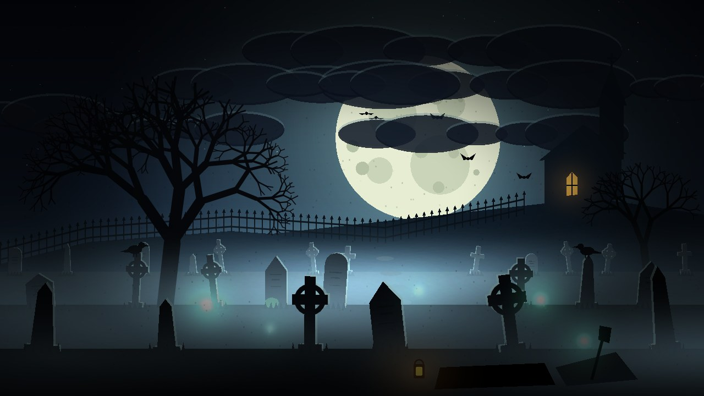 | **Horror** 3/3<br>Hollow Hill Cemetery | Gothic silhouettes against a huge moon: a recursive dead tree, tombstone recipes leaned by a hash, fog layers between the rows, crows, bats, will-o'-wisps. **Click** for lightning. | moonshine, shack | Gothic platformers, spooky-cute games, title screens |
|  | **Low-Poly** 1/3<br>Faceted Peaks | Scattered points → Delaunay triangles → each one samples a hidden "scene function" for its colour. **Click** to reroll the landscape and palette, **W** shows the wireframe. | delaunay, hsluv, vivid | Minimalist puzzle, hyper-casual, stylised flight |
| 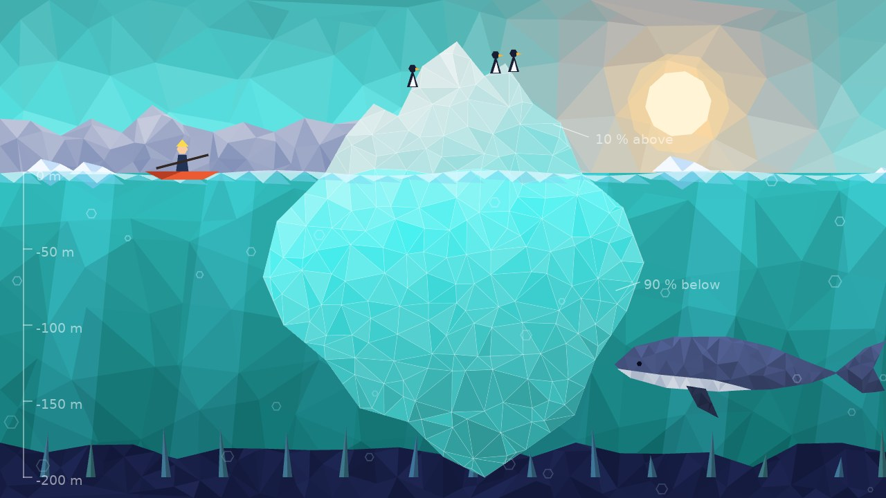 | **Low-Poly** 2/3<br>Tip of the Iceberg | Any outline → facets (`core/facets.lua`): edge points + interior points → Delaunay → trim. A split-level iceberg, bright above the waterline and deep blue below, plus a whale bent by a sine. **Click** to reroll. | delaunay, hsluv, vivid | Diving and exploration, calm puzzle games, infographics |
| 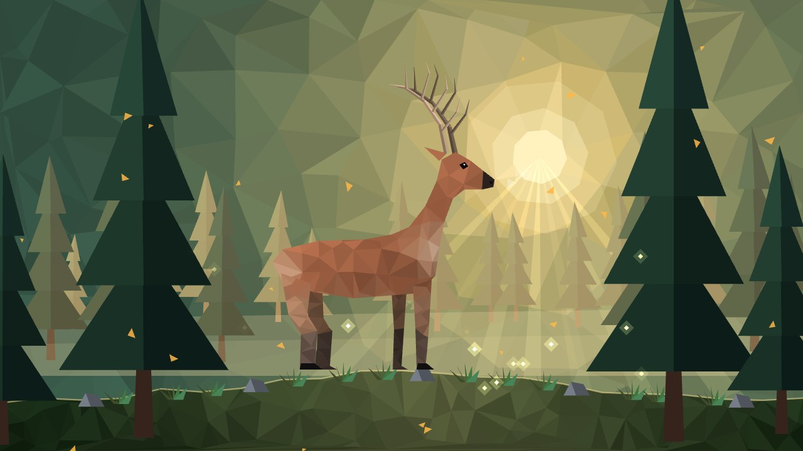 | **Low-Poly** 3/3<br>The Forest King | A character from typed outlines: torso, legs and ear are coordinate lists filled with facets and shaded by a colour function. Tapered-quad antlers, two-tone triangle pines, golden-hour backdrop. | delaunay, hsluv, vivid | Stylised wildlife games, card art, walking sims |
|  | **Hand-Drawn** 1/3<br>Doodle Notebook | Jittered double strokes that "boil" 8×/sec. Stencil-clipped hatching. Per-letter handwriting. Generated paper. A turtle draws a spiral live. | turtle.lua | Doodle games, educational, journals |
|  | **Hand-Drawn** 2/3<br>Chalkboard | Chalk is drawn into a canvas, then broken up by a grain shader. Mottled slate with eraser swipes. A curve keeps drawing itself, with chalk dust. | draft | Educational, classroom puzzles, briefings |
|  | **Hand-Drawn** 3/3<br>Blueprint | Grid paper, dimension lines with arrowheads, callouts, a title block. Ruler-steady strokes. A rotating plan view and meshing gears. | moonshine | Building sims, crafting, tech trees |
|  | **Isometric** 1/3<br>Tiny Isle | 2:1 iso projection by hand. Height-mapped tile columns. Depth sorting by z-queue. Villagers and a boat as classes moving with tweens. Mouse-hover tile picking. | deep, classic, tween.lua | City builders, cosy sims |
|  | **Isometric** 2/3<br>Neon City Block | Towers with windows placed in each face's (u, v) coordinates and lit by a hash. Rooftop neon, blinking antennas, cars with headlights, bloom. | deep, classic, moonshine | City builders, cyberpunk tactics |
|  | **Isometric** 3/3<br>Tactics Battle | Move range by BFS with climb limits, a path arrow, attack tiles, HP bars, a turn order, an action menu, damage pop-ups. The battle is a sequential script with `wait()`. | hump.timer, tween.lua, flux, deep, classic | Tactics RPGs, turn-based roguelites |
|  | **Watercolor** 1/3<br>Harbour Morning | Each wash is 5 jittered transparent layers with darker pooled edges. Sky blooms, paper grain, a deckled unpainted border. | vivid | Storybook adventures, cosy travel |
| 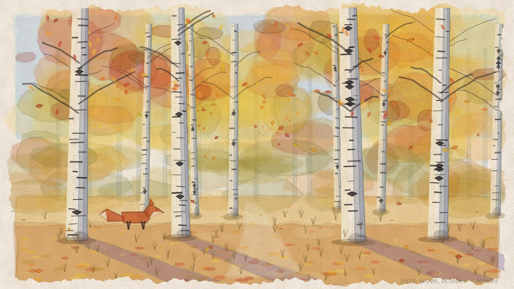 | **Watercolor** 2/3<br>Birch Grove, October | Foliage flooded in as ~150 overlapping blooms. Birch trunks are bare paper, defined only by a grey shadow side and dark scars. Violet cast shadows, splatter, falling leaves and a fox as live washes. | vivid | Seasonal storybooks, foraging and photo games |
| 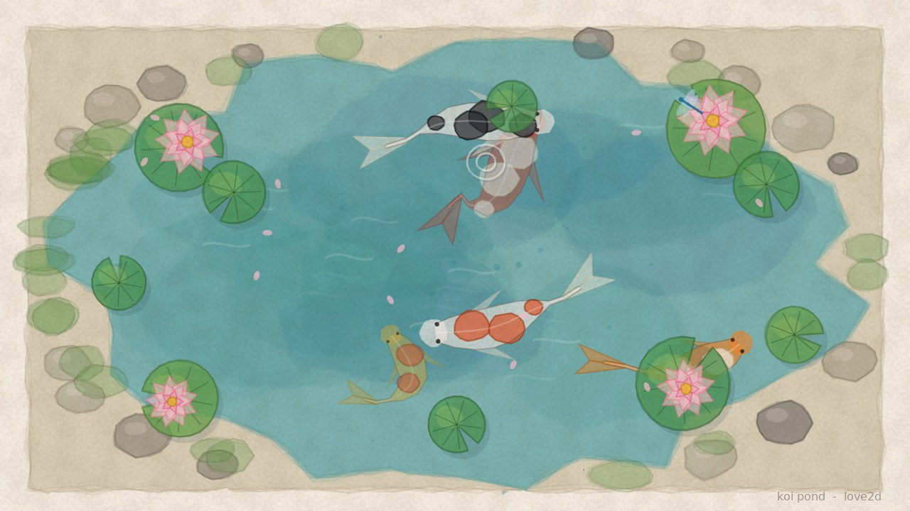 | **Watercolor** 3/3<br>Koi Pond | Top-down pond. Each koi is a spine trailing its head with a wiggle that grows toward the tail; live washes keep a fixed seed so edges don't boil. Deep fish sit under a glaze of water. **Click** for ripples. | vivid | Zen games, garden and fish-keeping sims |
|  | **Ink Wash** 1/3<br>Misty Peaks | Mountains fade from dark ridges into the paper. Brush strokes are Bezier triangle strips that follow pen pressure, with dry-brush streaks. Bamboo, a crane, a red seal. | (none) | Martial arts, meditative, historical |
| 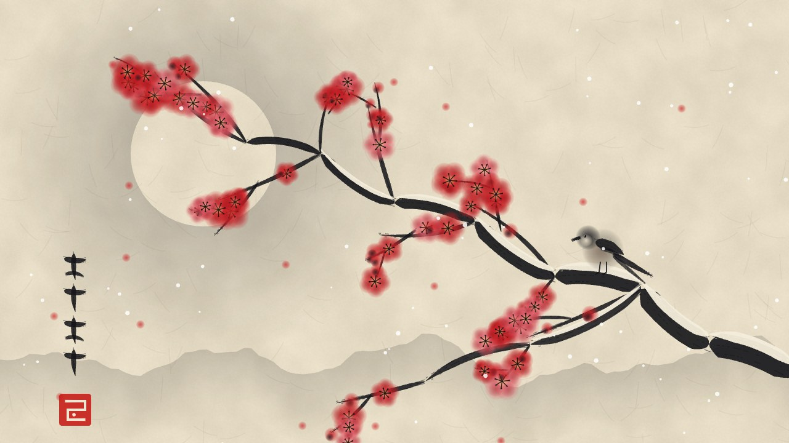 | **Ink Wash** 2/3<br>Plum Blossom, First Snow | The picture paints itself: every stroke has a start time and draws only part of its curve, so the branch grows trunk → limbs → twigs, blossoms bloom as twigs finish, and a bird lands. **Click** to repaint. | (none) | Calligraphy games, chapter cards, idle games |
| 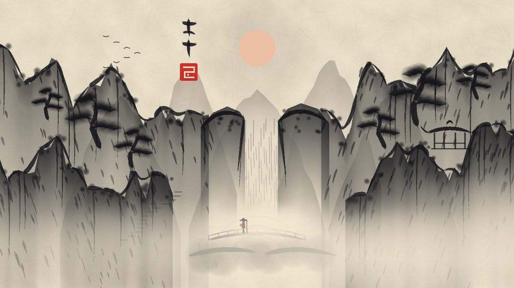 | **Ink Wash** 3/3<br>The Gorge at Dawn | Shan-shui: three distances of cliffs, each a wash that fades to bare paper (the mist). The waterfall is unpainted paper with a few moving lines. Clinging pines, a pavilion, a tiny traveller on a bridge. | (none) | Wuxia adventures, pilgrimage games, maps |
|  | **Comic Book** 1/3<br>Neon City Nights | Colour printed through a CMY halftone shader. Crisp black inks on top. Balloons, a caption box, speed lines, an extruded "KRAKOOM!", page shake. | draft, flux, shack | Brawlers, motion comics, card reveals |
| 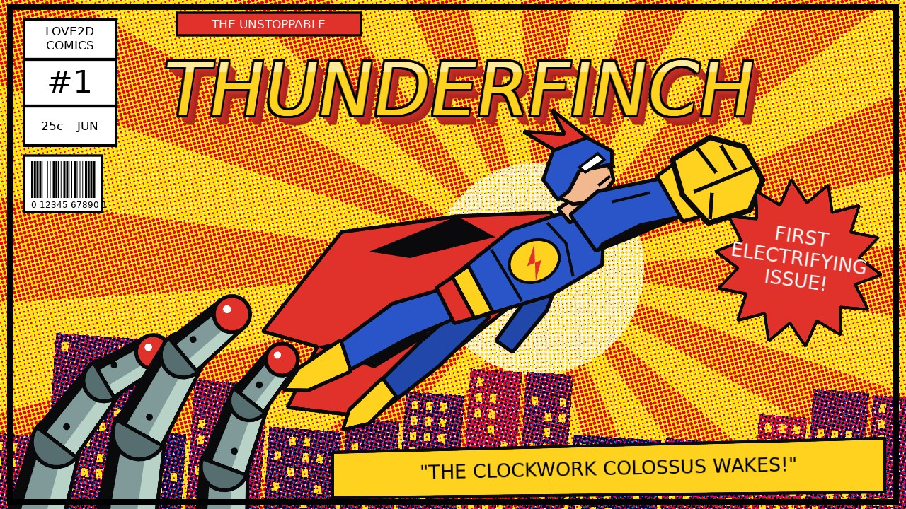 | **Comic Book** 2/3<br>Issue #1 Cover | A cover layout: extruded sheared masthead, corner box, starburst blurb, banner. A foreshortened flying hero and a robot hand painted back-to-front in flat colour and ink over a halftone sunburst. | flux | Superhero games, title screens, card reveals |
| 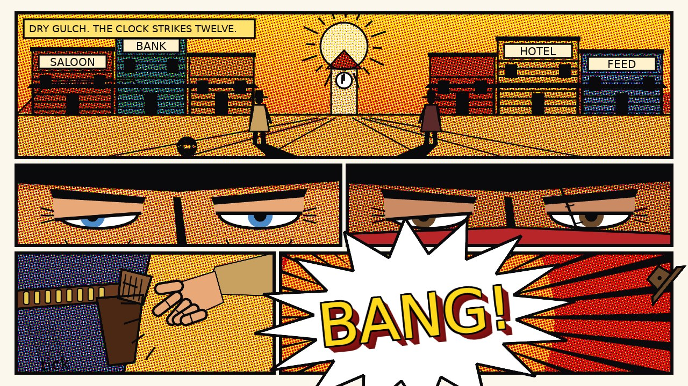 | **Comic Book** 3/3<br>High Noon at Dry Gulch | Pacing by layout: one wide panel, two extreme close-ups, a hand over a holster, and a BANG that breaks its frame. One clock drives eyelids, fingers and sweat. **Click** to draw. | flux, shack | Quick-draw duels, interactive comics, cutscenes |
|  | **Papercraft** 1/3<br>Paper Forest Diorama | Stacked cutouts with soft shadows, lit cut edges and fibre texture. A folded-paper sun, origami birds, mouse parallax. | vivid | Crafted puzzle-platformers, storybooks |
| 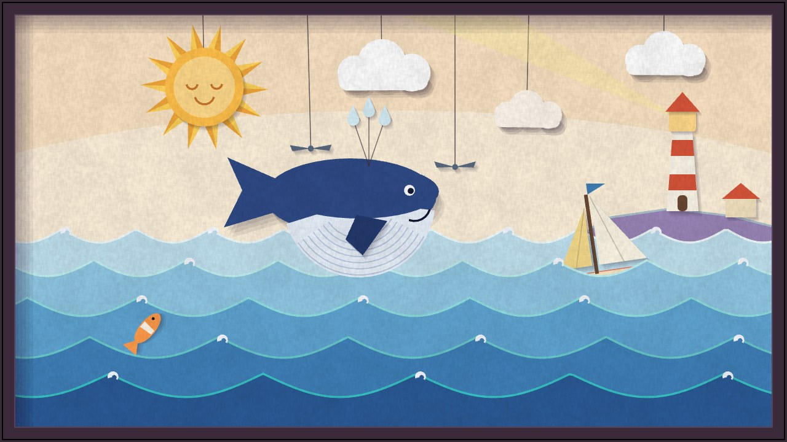 | **Papercraft** 2/3<br>Toy-Theatre Ocean | Five scalloped wave strips sliding out of step. A breaching whale, a sailboat and a fish are simply drawn *between* strips, so the waves hide them. Sun, clouds and gulls hang from threads as pendulums. | vivid | Storybooks, toy-like puzzles, level maps |
| 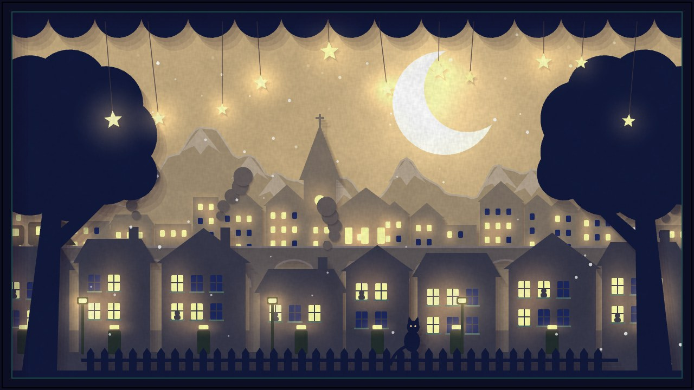 | **Papercraft** 3/3<br>Night Town Light Box | A backlit paper-cut box: sheet colour = mix(lamp, night, depth), so the back glows and the front goes dark. Windows are holes showing the lamp. A paper train, hanging stars, mouse parallax. | vivid | Bedtime-story games, seasonal events, save rooms |
|  | **Underwater** 1/3<br>Bioluminescent Reef | Light shafts, a caustics shader, glowing coral tips, pulsing jellyfish and a boids fish school. | brinevector, moonshine | Ocean exploration, aquarium sims, ambient |
| 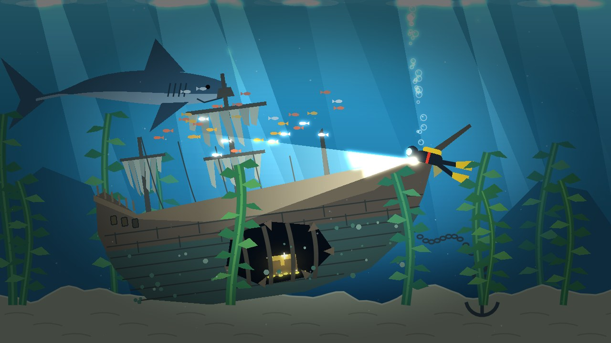 | **Underwater** 2/3<br>The Wreck of the Marigold | Depth as colour: every object is mixed toward the water colour by its distance. A sunken ship with a breach and treasure, kelp with phase-delayed sway, a shark on a sine-bent spine, a diver whose torch follows the **mouse**. | moonshine | Diving and treasure hunting, underwater metroidvanias |
| 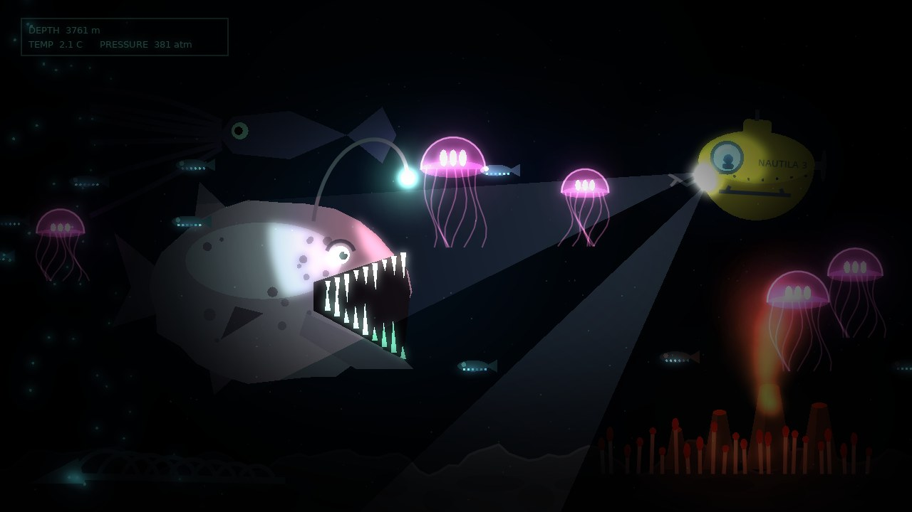 | **Underwater** 3/3<br>The Midnight Zone | No sunlight: the scene is multiplied by a near-black light map holding only an anglerfish's lure, a submersible's lamps and a vent's glow. Emissive creatures are added afterwards. **Click** to send a wave of plankton light. | moonshine | Deep-sea exploration and horror, submarine sims |

## Code map

```
main.lua            gallery, style/scene switching, --snapshots / --tour / --selftest
                    (STYLES at the top lists every style and its scenes)
conf.lua            window settings (audio is off: nothing here makes sound)
core/view.lua       1280x720 virtual screen, letterboxed to any window size
core/gfx.lua        shared helpers: gradients (Mesh), noise (fbm), generated textures,
                    hearts, ridges, sprites-from-strings, outlined text
core/pixelfont.lua  the 3x5 pixel font (glyphs as strings -> ImageFont)
core/sketchy.lua    wobbly hand-drawn strokes, hatching and handwriting
core/facets.lua     any outline -> low-poly facets (Delaunay + trim + colour function)
core/washkit.lua    watercolour: washes, blooms, brush strokes, splatter, paper, border
core/inkkit.lua     ink wash: pressure brush strokes (can be drawn partially), fading
                    washes, pines, seal, rice paper
core/comickit.lua   comics: CMY halftone shader, two-pass page, balloons, captions,
                    bursts, extruded lettering, speed lines
core/paperkit.lua   papercraft: cutouts with soft shadows, fibre, frame, threads
core/noirkit.lua    noir: film grade, light-map helpers, rain, letterbox
core/ui.lua         gallery grid (rotating thumbnails), HUD, scene pill, info panel
scenes/<id>.lua     one scene per file: load / update / draw (+ optional input)
lib/                the third-party libraries (MIT licensed, see lib/LICENSES/)
docs/screenshots/   output of --snapshots
```

A scene is a table with `title`, `subtitle`, `blurb`, `techniques`, `libs`, `genres` and the
functions `load`, `update(dt)` and `draw()`. It can also have `mousepressed`, `keypressed` and
`wheelmoved`. To add a scene, copy one, rename it and add its id to a style line in `STYLES` in
`main.lua` (or add a new line for a new style).

The first scene of each style keeps all its helpers inline, so it reads as one complete
recipe. The second and third scenes share the `core/*kit.lua` files above, which is closer to
how you would organise a real game.

## The techniques that come up again and again

These are the reusable ideas behind most of the styles. They're worth naming when you ask an
AI to generate LÖVE art.

- **Noise is the universal material.** `love.math.noise` stacked in octaves (fbm, see
  `core/gfx.lua`) makes clouds, mountains, terrain, fog, paper grain, planets and rock.
  Domain warping (noise of noise) makes nebulae.
- **Bake once, draw many.** Anything static (brick walls, forest floors, paper, planet textures,
  pixel-art backgrounds) is drawn once into a `Canvas` or `ImageData` at load time and reused.
- **Meshes with vertex colours** give smooth gradients with no textures.
- **Light maps.** Draw the scene, then multiply a "light canvas" over it (noir, horror). Things
  that emit light are drawn *after* that step so darkness never touches them.
- **Post-processing chains** (moonshine) change the whole mood in one line: black & white,
  bloom, CRT, film grain, vignette.
- **Sprites as strings** (pixel art), **levels as ASCII** (dungeon, handheld) and **SVG as
  strings** (space ship) keep art inside the code, where an AI can read and edit it.
- **Draw in passes.** Colour first, then a shader (halftone, chalk grain, heat shimmer), then
  crisp line art on top. Comics, chalk and dunes all work this way.
- **Mirror for water.** Render the top half into a canvas and draw it flipped below the
  horizon, with ripples (lakes, lantern lake, frozen lake).
- **Seeded randomness and hashing** keep procedural worlds stable between frames and between
  runs.
- **Outline in, picture out.** A list of points is enough for a character or a landmark: fill
  it with facets (`core/facets.lua`), wash it (`core/washkit.lua`), or cut it from paper
  (`core/paperkit.lua`). The stag, the iceberg, the whale and the fox are all coordinate lists.
- **Spines.** A fish, a shark or a vine is a chain of points with a sine wave travelling along
  it; the body is built around the chain every frame (koi, shark, kelp, whale).
- **Perspective by hand.** `screen = centre + world * focal / z` is all it takes for a
  tunnel, a corridor or a grid; cut the depth into slices and shade each slice.
- **Occlusion by draw order.** Put a thing between two layers (wave strips, fog rows, cloud
  depths) and the front layer hides it. No masks needed.
- **Timed strokes.** Give every stroke a start time and draw only part of its curve: the
  picture draws itself (plum blossom).

## Libraries

### Included and used

All come from awesome-love2d and are MIT licensed (licences in `lib/LICENSES/`).

| Library | Used in | For |
|---|---|---|
| [moonshine](https://github.com/vrld/moonshine) | most scenes (all noir, space, neon, horror, underwater) | Post effects: glow, god rays, CRT, scanlines, film grain, vignette, desaturate, chromatic aberration |
| [lighter](https://github.com/speakk/lighter) | noir, horror | 2D lights with ray-cast shadows |
| [flux](https://github.com/rxi/flux) | cartoon (all 3), romantic, lanterns, jungle temple, tactics, comic (all 3) | Chained tweens (squash & stretch, heartbeat, pop-ups) |
| [tween.lua](https://github.com/kikito/tween.lua) | isometric, tactics | Tile-to-tile movement |
| [hump](https://github.com/HDictus/hump) (camera, timer) | cartoon, monster picnic, adventure, jungle temple, tactics | Camera; timed events; `timer:script` for sequential choreography |
| [love-parallax](https://github.com/idbrii/love-parallax) | adventure | Parallax layers relative to a camera |
| [SYSL-Text](https://github.com/sysl-dev/SYSL-Text) | adventure | Typewriter dialogue with animated tags |
| [maid64](https://github.com/adekto/maid64) | pixel | Low-res canvas with nearest-neighbour scaling |
| [Bresenham](https://github.com/rm-code/Bresenham) | pixel, dungeon | Pixel-perfect lines and line-of-sight |
| [tick](https://github.com/rxi/tick) | pixel | Recurring events |
| [brinevector](https://github.com/novemberisms/brinevector) | underwater, floating isles | Fast 2D vectors for the boids fish school and the airship |
| [hsluv](https://github.com/hsluv/hsluv-lua) | romantic (all 3), lowpoly (all 3), hyperloop | Perceptually even colour palettes |
| [vivid](https://github.com/WetDesertRock/vivid) | lowpoly, watercolor and papercraft (all 3 of each) | Lighten/darken colours in HSL |
| [draft](https://github.com/pelevesque/draft) | cartoon (all 3), chalkboard, comic | Stars, bursts and concave polygons |
| [delaunay](https://github.com/Yonaba/delaunay) | lowpoly (all 3) | Triangulation |
| [lovector](https://github.com/nasso/lovector) | space | Renders SVG markup |
| [turtle.lua](https://github.com/arthurealike/turtle.lua) | sketch | Logo-style turtle drawing |
| [deep](https://github.com/Nikaoto/deep) | isometric (all 3), floating isles | Z-ordered draw queue |
| [classic](https://github.com/rxi/classic) | isometric (all 3) | Tiny class library |
| [shack](https://github.com/Ulydev/shack) | neon, hyperloop, horror (all 3), comic, western | Screen shake and zoom pulses |

**Small patches** (each one is marked `[style-showcase patch]` in the source):

- `lib/lighter/init.lua`: the default light falloff used to be a PNG. It's now generated in
  code, so the folder has no image files.
- `lib/turtle/turtle.lua`: it now loads its vector helper with a relative `require`, and its
  leftover debug `print`s are removed.

### From the list, but not included (and why)

The brief was art made from code, so libraries that exist to *load art files* don't apply.
Some others overlap with a library already used here, and a few predate LÖVE 11's colour API.

| Library | Why not |
|---|---|
| anim8, Peachy, Aseprite loader, animX, Lump, chiro, Artal, svglover, Runtime/Export-TextureAtlas, Autobatch, iffy, STI, cartographer | They load or batch image, Aseprite, Flash, Spine, PSD or Tiled files. There are no asset files here. |
| renderplanet | It's a demo app driven by PNG textures. `space.lua` does the same job with generated textures and a shader. |
| skeletor, lue | They use LÖVE 0.10's 0–255 colours (LÖVE 11 uses 0–1). They'd work with a conversion, but there was no need. |
| push, Shöve, Sunscreen, Resolution Solution, SYSL-Pixel, center | Resolution scalers that do the same job as maid64 + `core/view.lua`. In a full game, **push** is a fine pick. |
| Light World, Shädows, bitumbra, Simple Love Lights | Lighting overlaps with lighter, which has the simplest API. bitumbra is worth a look if you need hundreds of lights. |
| gamera, Brady, Editgrid, roomshift | Cameras that overlap with hump.camera. |
| hump.gamestate/class/vector, knife, NAniTe, cpml, vornmath, lume | Useful general tools, but nothing in this showcase needed them. |
| HSLuv alternatives (grove.color, hex2color) | hsluv + vivid cover it. hex2color has no licence file. |
| GifCat, ShaderScan, LoveShaderConverter, Hot Particles, particle editors | Dev tools (GIF capture, shader hot-reload, editors). Handy while working, but not runtime art. |
| L5 | A Processing/p5.js port that takes over LÖVE's callbacks. It's a different way to work, best tried on its own. |

## Notes

- Tested with LÖVE 11.5 on Linux (`--selftest` passes for all 51 scenes, including making a
  gallery thumbnail for each one, releasing it and loading it again). Frame rate wasn't
  measured, and nothing was tried by hand with a mouse, because that machine had no GPU or
  input devices. The shader-heavy scenes (the three realistic ones, space, neon, comic and
  underwater) are the most demanding; the watercolour and ink scenes redraw many small
  shapes every frame.
- The gallery makes thumbnails for the second and third scene of each style a few per second
  after it opens (so start-up stays quick), then forgets what those scenes loaded. Expect the
  thumbnails to fill in over the first ten seconds or so.
- `deep` only draws whole-number z values: a fractional z is silently skipped.
- Screenshots in `docs/` are JPEG to keep the repo small (pixel art stays PNG).
  `--snapshots` itself writes PNGs.
- Nothing in this folder is tied to the Pan-Galactic game. You can copy `style-showcase/`
  anywhere and run `love .` inside it.
