# LÖVE Style Showcase: art with code only

Seventeen art styles and 27 scenes in [LÖVE 11.5](https://love2d.org), and **not one image
file**. Every sprite, texture, font, gradient and effect is generated by Lua code (and some
inline GLSL shaders) when the program starts. It uses 20 libraries from
[awesome-love2d](https://github.com/love2d-community/awesome-love2d).

It's a reference for picking a look for a game and for seeing how each look is built. Each
scene is one self-contained file in `scenes/`, commented from top to bottom like a recipe.
Five styles (Pixel Art, Romantic, Realistic, Hand-Drawn and Isometric) have three scenes each,
to show how much range one look can have.

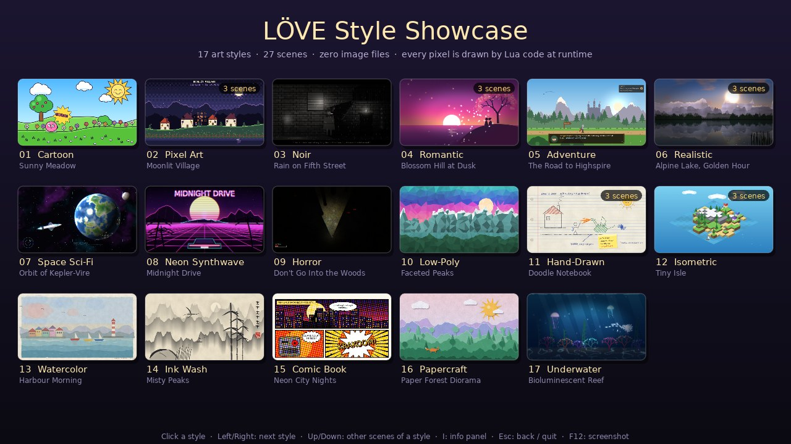

## Run it

From the repository root (the folder above this one):

```bash
love style-showcase
```

| Command | What it does |
|---|---|
| `love style-showcase` | Opens the gallery. Click a style. |
| `love style-showcase --scene pixel_dungeon` | Starts on one scene (use its file name in `scenes/`). |
| `love style-showcase --tour 8` | Slideshow: moves to the next scene every 8 seconds. |
| `love style-showcase --snapshots` | Saves a PNG of every scene, then quits. |
| `love style-showcase --selftest` | Loads, clicks, presses keys in and draws every scene, then quits. Exit code 0 means it passed. |
| add `--only <id>` | Loads only one scene. Faster while you tweak it. |

**Controls:** Left/Right arrows switch style, Up/Down switch between the scenes of a style (or
click the yellow scene pill), **I** opens the *How it's made* panel (techniques, libraries,
matching genres), Esc goes back to the gallery, F11 toggles fullscreen and F12 saves a
screenshot. Some scenes respond to the mouse or keys; the info panel says how.

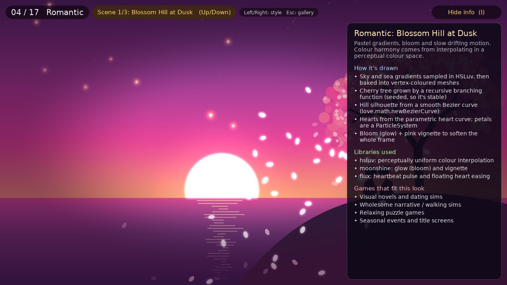

> `love .` in the repo root still runs the Pan-Galactic game; this folder is separate. If you
> zip the repo root into a `.love` file for the game, leave `style-showcase/` out.

## The styles

| | Style / scene | How it's drawn | Libraries | Good for |
|---|---|---|---|---|
| 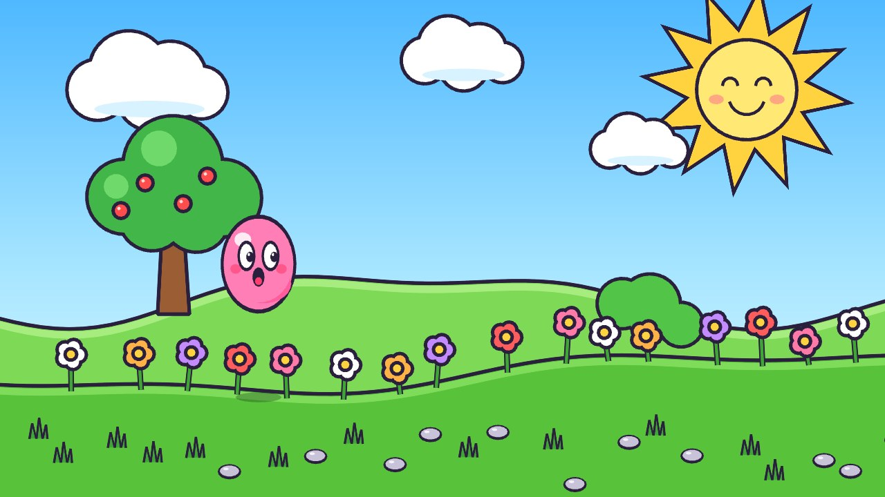 | **Cartoon**<br>Sunny Meadow | Every shape drawn twice (outline, then fill). Squash & stretch on a single ellipse. Comic "BOING!" burst. | flux, hump.timer, draft | Platformers, kids' and casual games, pet sims |
| 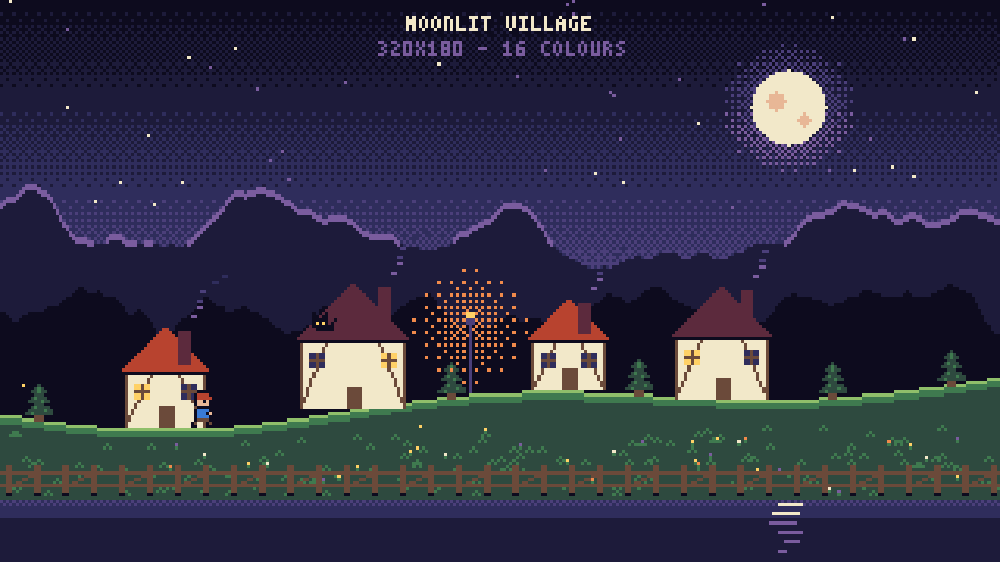 | **Pixel Art** 1/3<br>Moonlit Village | Real 320×180 canvas with a 16-colour palette, scaled ×4. Sprites and a 3×5 pixel font are strings in the code. Bayer-dithered sky and lamp glow. | maid64, Bresenham, tick | Retro platformers, RPGs, jams |
| 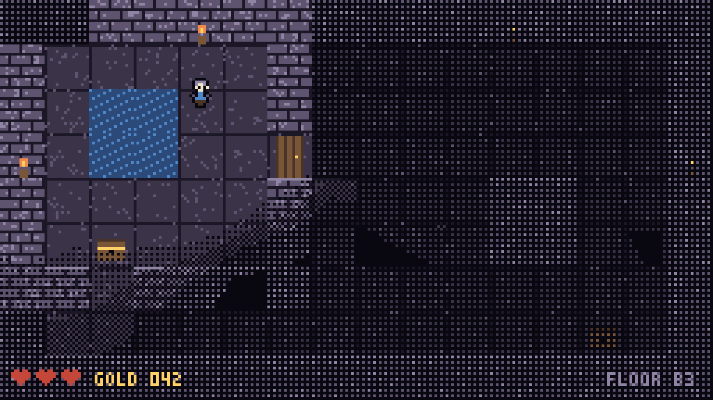 | **Pixel Art** 2/3<br>Torchlit Dungeon | ASCII level map. Field of view from Bresenham rays. Torch and lantern light quantised into 4 dithered levels, so no new colours appear. The hero paths with BFS. | Bresenham | Roguelikes, dungeon crawlers, stealth |
| 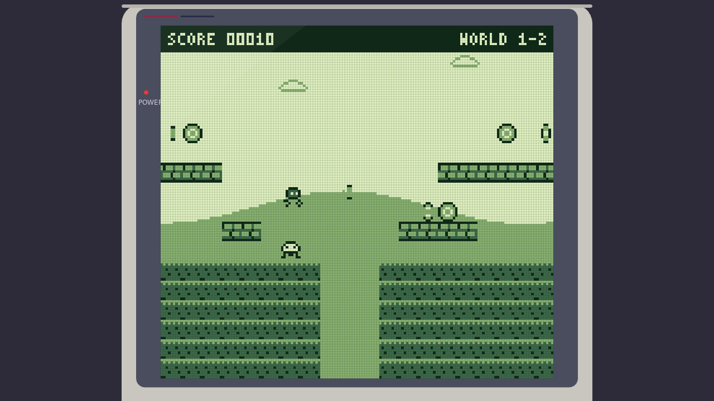 | **Pixel Art** 3/3<br>4-Shade Handheld | 160×144 screen with only 4 shades. LCD ghosting, a visible pixel grid and a drawn handheld bezel. Jump physics, spinning coins. | (none) | Handheld-style platformers, demakes |
| 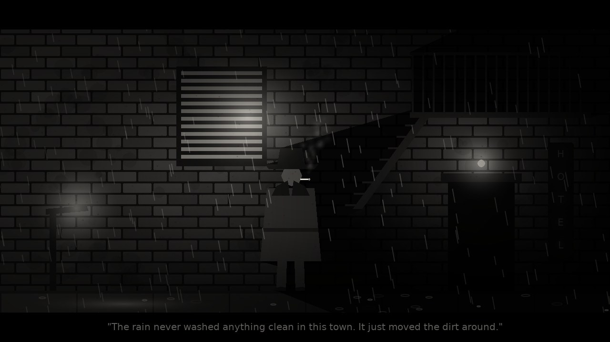 | **Noir (B&W)**<br>Rain on Fifth Street | Drawn in colour, then graded to black & white in post (press **C** to compare). Ray-cast shadows, rain, cigarette smoke, letterbox. | lighter, moonshine | Detective / mystery, stealth, narrative |
| 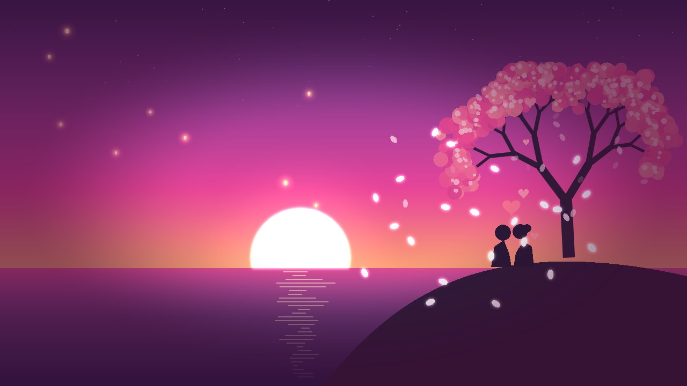 | **Romantic** 1/3<br>Blossom Hill at Dusk | Sunset gradient interpolated in HSLuv, a recursively grown cherry tree, a heartbeat on chained tweens, petal particles, bloom. | hsluv, moonshine, flux | Visual novels, dating sims |
| 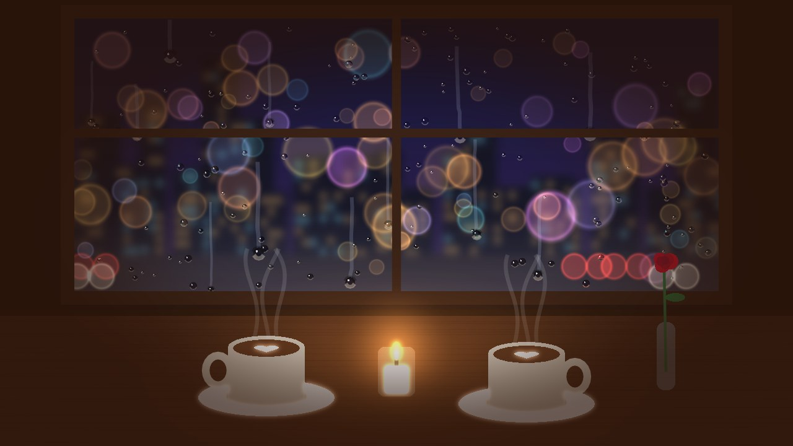 | **Romantic** 2/3<br>Rainy Café Window | The city outside is blurred once (depth of field). Bokeh discs. Raindrops act as tiny lenses that show the street upside down. Candlelight and steam. | moonshine, hsluv | Cosy narrative, café sims, lo-fi ambient |
| 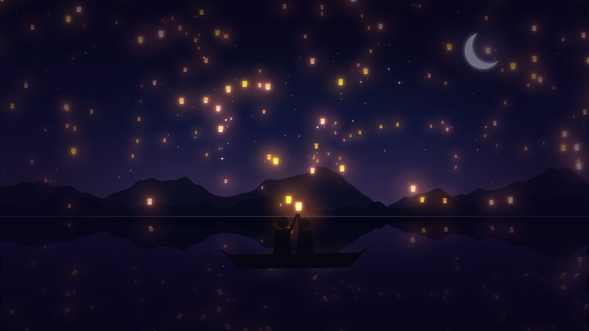 | **Romantic** 3/3<br>Lantern Lake | Hundreds of sky lanterns. The upper half is mirrored into the lake in rippling strips. New lanterns float up from the boat. | flux, hsluv, moonshine | Festival events, finales, relaxing toys |
| 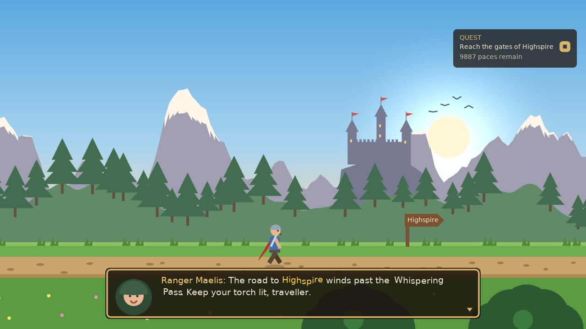 | **Adventure**<br>The Road to Highspire | 5 parallax layers with atmospheric perspective. An infinite world placed by hashing. Procedural walk cycle. Typewriter RPG dialogue with `[bounce]`/`[shake]` tags. | hump.camera, love-parallax, SYSL-Text, hump.timer | Action-adventure, side-scrolling RPGs |
| 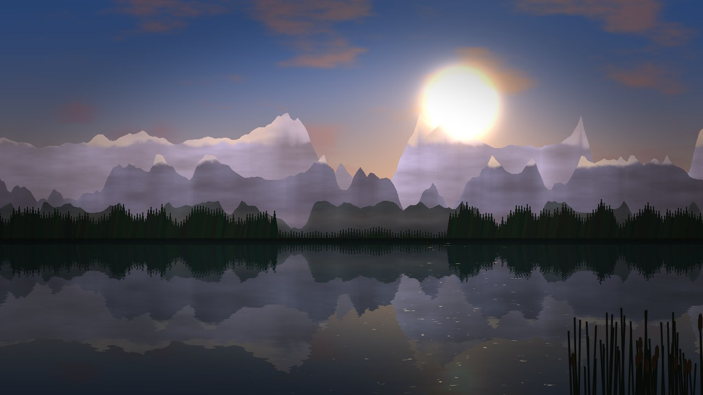 | **Realistic** 1/3<br>Alpine Lake, Golden Hour | Sky, cloud, rock/snow and water shaders. Hazy mountain layers. The lake is the scene mirrored through a ripple + Fresnel shader. God rays from an occlusion mask. | moonshine | Exploration, nature, premium menus |
| 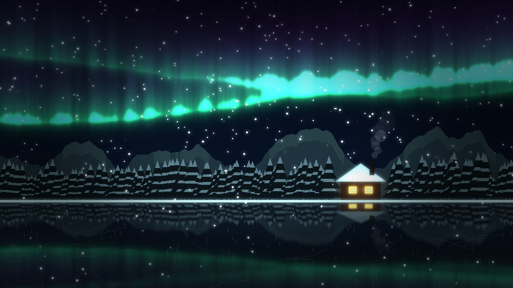 | **Realistic** 2/3<br>Northern Lights | Aurora shader: a moving hem line, light fading upward, stretched-noise rays, colour shifting green to violet. Snowy pines, a warm cabin, a frozen lake, snowfall. | moonshine | Cold-climate survival, quiet adventures |
| 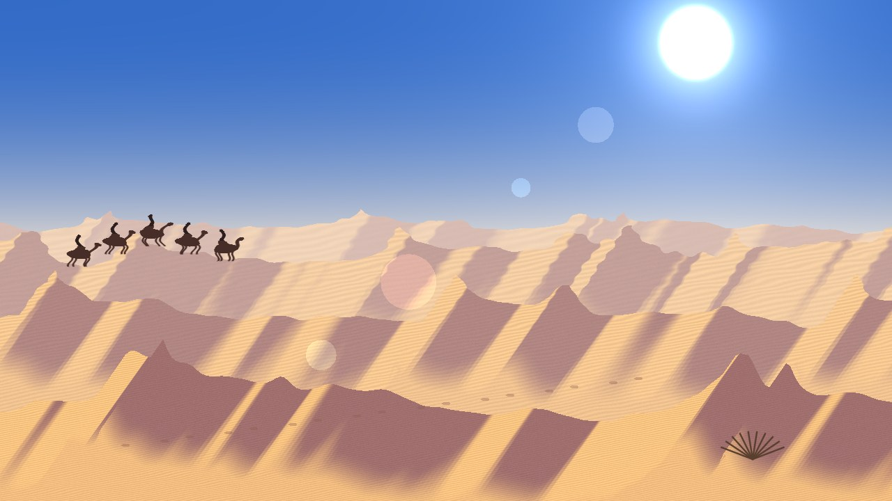 | **Realistic** 3/3<br>Desert Dunes | A sand shader with a lit face, a shadowed slip face and wind ripples. Slanted crest bands. A heat-shimmer post shader, a lens flare, a camel caravan. | moonshine | Open-world, rally, desert adventures |
| 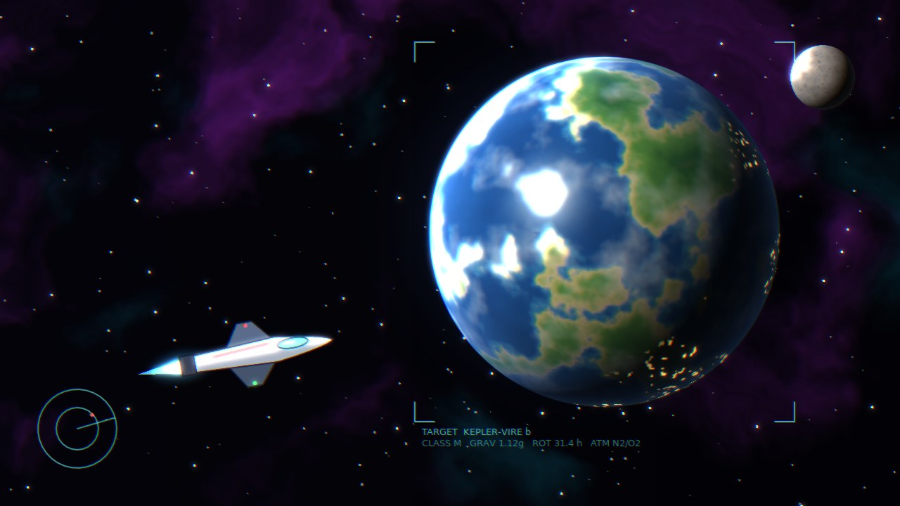 | **Space Sci-Fi**<br>Orbit of Kepler-Vire | Rotating planet shader: textures from 3D noise, lighting, clouds, city lights at night, atmosphere. Domain-warped nebula. The ship is an **inline SVG string**. | lovector, moonshine | Shooters, 4X, space sims, sci-fi UI |
| 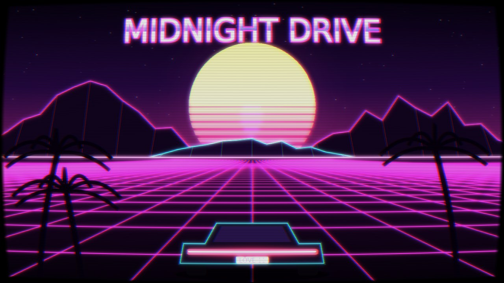 | **Neon Synthwave**<br>Midnight Drive | Every line drawn twice (wide and dim, then thin and bright) plus bloom. A hand-projected 3D grid. A striped sun. A chrome text shader. CRT, scanlines and chromatic aberration. A pulse on the beat. | moonshine, shack | Arcade racers, rhythm, vector shooters |
| 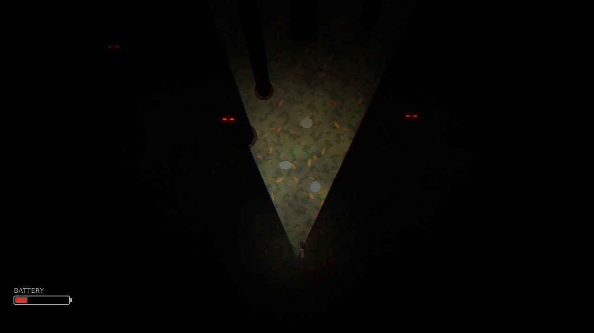 | **Horror**<br>Don't Go Into the Woods | Shadow-casting flashlight cone. Mist that only shows inside the beam. Eyes that hide from the light. Lightning reveals with screen shake. | lighter, moonshine, shack | Survival horror, stealth, fog-of-war games |
| 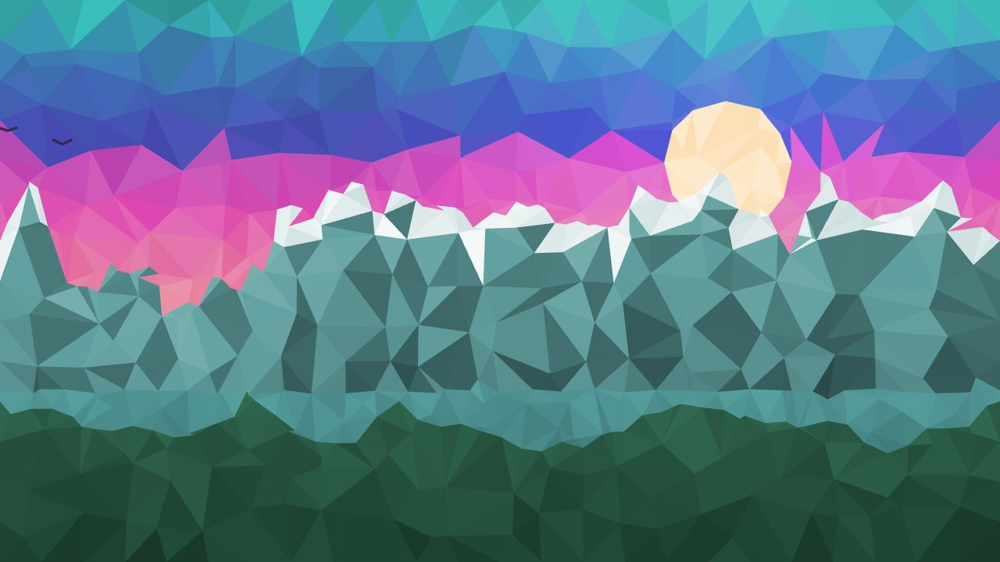 | **Low-Poly**<br>Faceted Peaks | Scattered points → Delaunay triangles → each one samples a hidden "scene function" for its colour. **Click** to reroll the landscape and palette, **W** shows the wireframe. | delaunay, hsluv, vivid | Minimalist puzzle, hyper-casual, stylised flight |
| 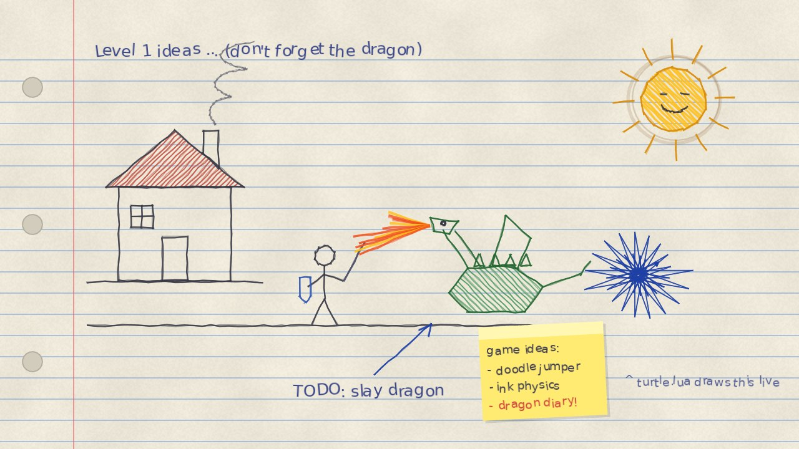 | **Hand-Drawn** 1/3<br>Doodle Notebook | Jittered double strokes that "boil" 8×/sec. Stencil-clipped hatching. Per-letter handwriting. Generated paper. A turtle draws a spiral live. | turtle.lua | Doodle games, educational, journals |
| 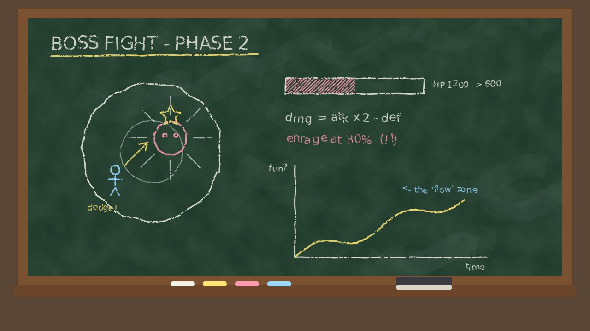 | **Hand-Drawn** 2/3<br>Chalkboard | Chalk is drawn into a canvas, then broken up by a grain shader. Mottled slate with eraser swipes. A curve keeps drawing itself, with chalk dust. | draft | Educational, classroom puzzles, briefings |
| 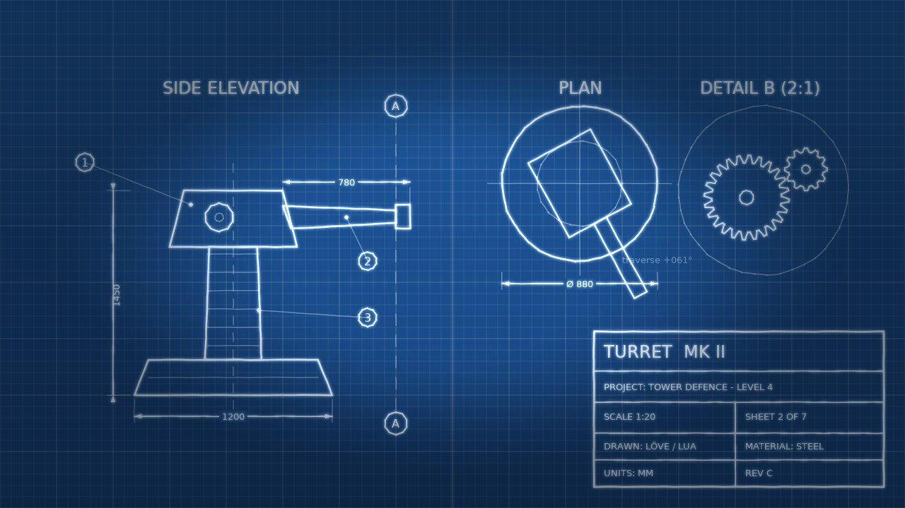 | **Hand-Drawn** 3/3<br>Blueprint | Grid paper, dimension lines with arrowheads, callouts, a title block. Ruler-steady strokes. A rotating plan view and meshing gears. | moonshine | Building sims, crafting, tech trees |
| 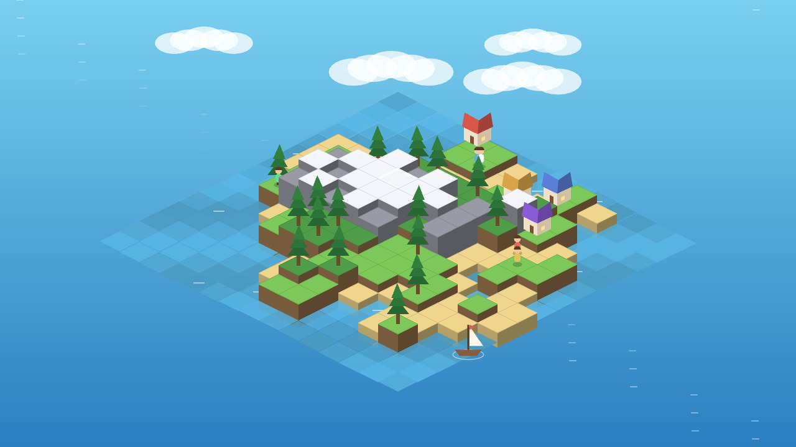 | **Isometric** 1/3<br>Tiny Isle | 2:1 iso projection by hand. Height-mapped tile columns. Depth sorting by z-queue. Villagers and a boat as classes moving with tweens. Mouse-hover tile picking. | deep, classic, tween.lua | City builders, cosy sims |
| 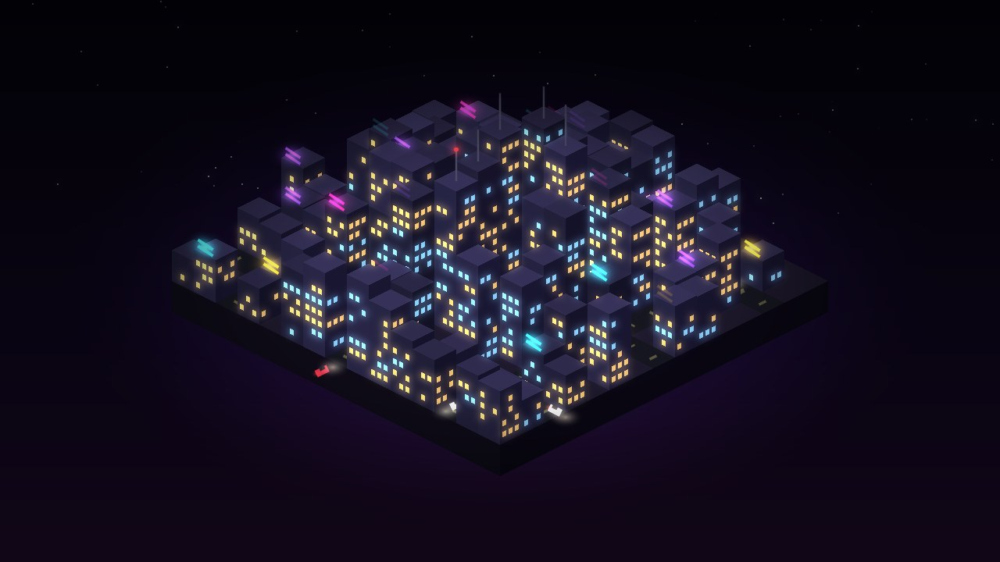 | **Isometric** 2/3<br>Neon City Block | Towers with windows placed in each face's (u, v) coordinates and lit by a hash. Rooftop neon, blinking antennas, cars with headlights, bloom. | deep, classic, moonshine | City builders, cyberpunk tactics |
| 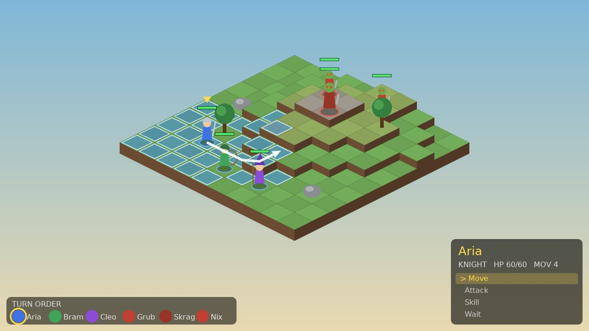 | **Isometric** 3/3<br>Tactics Battle | Move range by BFS with climb limits, a path arrow, attack tiles, HP bars, a turn order, an action menu, damage pop-ups. The battle is a sequential script with `wait()`. | hump.timer, tween.lua, flux, deep, classic | Tactics RPGs, turn-based roguelites |
| 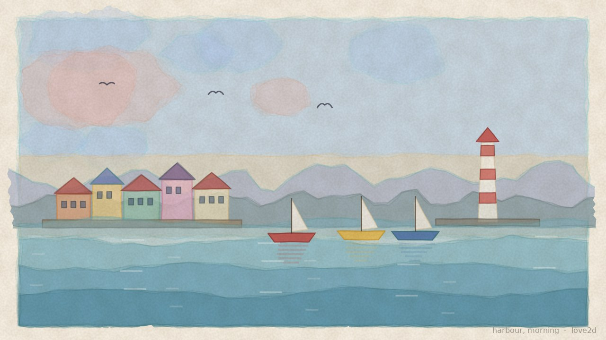 | **Watercolor**<br>Harbour Morning | Each wash is 5 jittered transparent layers with darker pooled edges. Sky blooms, paper grain, a deckled unpainted border. | vivid | Storybook adventures, cosy travel |
| 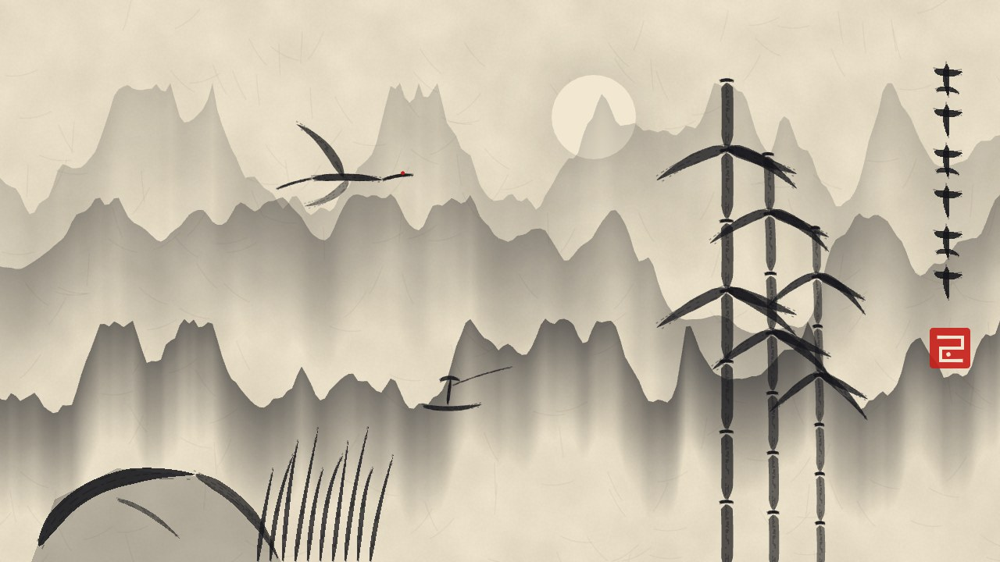 | **Ink Wash**<br>Misty Peaks | Mountains fade from dark ridges into the paper. Brush strokes are Bezier triangle strips that follow pen pressure, with dry-brush streaks. Bamboo, a crane, a red seal. | (none) | Martial arts, meditative, historical |
| 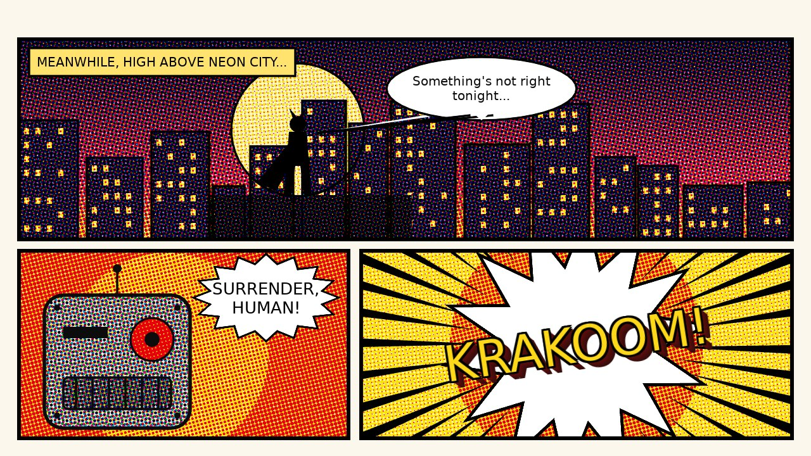 | **Comic Book**<br>Neon City Nights | Colour printed through a CMY halftone shader. Crisp black inks on top. Balloons, a caption box, speed lines, an extruded "KRAKOOM!", page shake. | draft, flux, shack | Brawlers, motion comics, card reveals |
| 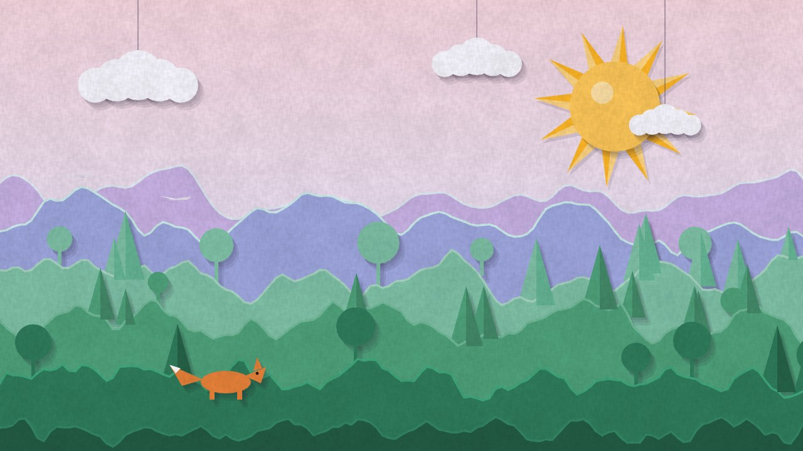 | **Papercraft**<br>Paper Forest Diorama | Stacked cutouts with soft shadows, lit cut edges and fibre texture. A folded-paper sun, origami birds, mouse parallax. | vivid | Crafted puzzle-platformers, storybooks |
| 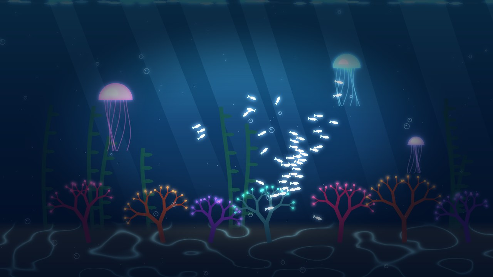 | **Underwater**<br>Bioluminescent Reef | Light shafts, a caustics shader, glowing coral tips, pulsing jellyfish and a boids fish school. | brinevector, moonshine | Ocean exploration, aquarium sims, ambient |

## Code map

```
main.lua            gallery, style/scene switching, --snapshots / --tour / --selftest
                    (STYLES at the top lists every style and its scenes)
conf.lua            window settings (audio is off: nothing here makes sound)
core/view.lua       1280x720 virtual screen, letterboxed to any window size
core/gfx.lua        shared helpers: gradients (Mesh), noise (fbm), generated textures,
                    hearts, ridges, sprites-from-strings, outlined text
core/pixelfont.lua  the 3x5 pixel font (glyphs as strings -> ImageFont)
core/sketchy.lua    wobbly hand-drawn strokes, hatching and handwriting
core/ui.lua         gallery grid, HUD, scene pill, "How it's made" panel
scenes/<id>.lua     one scene per file: load / update / draw (+ optional input)
lib/                the third-party libraries (MIT licensed, see lib/LICENSES/)
docs/screenshots/   output of --snapshots
```

A scene is a table with `title`, `subtitle`, `blurb`, `techniques`, `libs`, `genres` and the
functions `load`, `update(dt)` and `draw()`. It can also have `mousepressed`, `keypressed` and
`wheelmoved`. To add a scene, copy one, rename it and add its id to a style line in `STYLES` in
`main.lua` (or add a new line for a new style).

## The techniques that come up again and again

These are the reusable ideas behind most of the styles. They're worth naming when you ask an
AI to generate LÖVE art.

- **Noise is the universal material.** `love.math.noise` stacked in octaves (fbm, see
  `core/gfx.lua`) makes clouds, mountains, terrain, fog, paper grain, planets and rock.
  Domain warping (noise of noise) makes nebulae.
- **Bake once, draw many.** Anything static (brick walls, forest floors, paper, planet textures,
  pixel-art backgrounds) is drawn once into a `Canvas` or `ImageData` at load time and reused.
- **Meshes with vertex colours** give smooth gradients with no textures.
- **Light maps.** Draw the scene, then multiply a "light canvas" over it (noir, horror). Things
  that emit light are drawn *after* that step so darkness never touches them.
- **Post-processing chains** (moonshine) change the whole mood in one line: black & white,
  bloom, CRT, film grain, vignette.
- **Sprites as strings** (pixel art), **levels as ASCII** (dungeon, handheld) and **SVG as
  strings** (space ship) keep art inside the code, where an AI can read and edit it.
- **Draw in passes.** Colour first, then a shader (halftone, chalk grain, heat shimmer), then
  crisp line art on top. Comics, chalk and dunes all work this way.
- **Mirror for water.** Render the top half into a canvas and draw it flipped below the
  horizon, with ripples (lakes, lantern lake, frozen lake).
- **Seeded randomness and hashing** keep procedural worlds stable between frames and between
  runs.

## Libraries

### Included and used

All come from awesome-love2d and are MIT licensed (licences in `lib/LICENSES/`).

| Library | Used in | For |
|---|---|---|
| [moonshine](https://github.com/vrld/moonshine) | most scenes | Post effects: glow, god rays, CRT, scanlines, film grain, vignette, desaturate, chromatic aberration |
| [lighter](https://github.com/speakk/lighter) | noir, horror | 2D lights with ray-cast shadows |
| [flux](https://github.com/rxi/flux) | cartoon, romantic, lanterns, tactics, comic | Chained tweens (squash & stretch, heartbeat, pop-ups) |
| [tween.lua](https://github.com/kikito/tween.lua) | isometric, tactics | Tile-to-tile movement |
| [hump](https://github.com/HDictus/hump) (camera, timer) | cartoon, adventure, tactics | Camera; timed events; `timer:script` for sequential choreography |
| [love-parallax](https://github.com/idbrii/love-parallax) | adventure | Parallax layers relative to a camera |
| [SYSL-Text](https://github.com/sysl-dev/SYSL-Text) | adventure | Typewriter dialogue with animated tags |
| [maid64](https://github.com/adekto/maid64) | pixel | Low-res canvas with nearest-neighbour scaling |
| [Bresenham](https://github.com/rm-code/Bresenham) | pixel, dungeon | Pixel-perfect lines and line-of-sight |
| [tick](https://github.com/rxi/tick) | pixel | Recurring events |
| [brinevector](https://github.com/novemberisms/brinevector) | underwater | Fast 2D vectors for the boids fish school |
| [hsluv](https://github.com/hsluv/hsluv-lua) | romantic (all 3), lowpoly | Perceptually even colour palettes |
| [vivid](https://github.com/WetDesertRock/vivid) | lowpoly, watercolor, papercraft | Lighten/darken colours in HSL |
| [draft](https://github.com/pelevesque/draft) | cartoon, chalkboard, comic | Stars, bursts and concave polygons |
| [delaunay](https://github.com/Yonaba/delaunay) | lowpoly | Triangulation |
| [lovector](https://github.com/nasso/lovector) | space | Renders SVG markup |
| [turtle.lua](https://github.com/arthurealike/turtle.lua) | sketch | Logo-style turtle drawing |
| [deep](https://github.com/Nikaoto/deep) | isometric (all 3) | Z-ordered draw queue |
| [classic](https://github.com/rxi/classic) | isometric (all 3) | Tiny class library |
| [shack](https://github.com/Ulydev/shack) | neon, horror, comic | Screen shake and zoom pulses |

**Small patches** (each one is marked `[style-showcase patch]` in the source):

- `lib/lighter/init.lua`: the default light falloff used to be a PNG. It's now generated in
  code, so the folder has no image files.
- `lib/turtle/turtle.lua`: it now loads its vector helper with a relative `require`, and its
  leftover debug `print`s are removed.

### From the list, but not included (and why)

The brief was art made from code, so libraries that exist to *load art files* don't apply.
Some others overlap with a library already used here, and a few predate LÖVE 11's colour API.

| Library | Why not |
|---|---|
| anim8, Peachy, Aseprite loader, animX, Lump, chiro, Artal, svglover, Runtime/Export-TextureAtlas, Autobatch, iffy, STI, cartographer | They load or batch image, Aseprite, Flash, Spine, PSD or Tiled files. There are no asset files here. |
| renderplanet | It's a demo app driven by PNG textures. `space.lua` does the same job with generated textures and a shader. |
| skeletor, lue | They use LÖVE 0.10's 0–255 colours (LÖVE 11 uses 0–1). They'd work with a conversion, but there was no need. |
| push, Shöve, Sunscreen, Resolution Solution, SYSL-Pixel, center | Resolution scalers that do the same job as maid64 + `core/view.lua`. In a full game, **push** is a fine pick. |
| Light World, Shädows, bitumbra, Simple Love Lights | Lighting overlaps with lighter, which has the simplest API. bitumbra is worth a look if you need hundreds of lights. |
| gamera, Brady, Editgrid, roomshift | Cameras that overlap with hump.camera. |
| hump.gamestate/class/vector, knife, NAniTe, cpml, vornmath, lume | Useful general tools, but nothing in this showcase needed them. |
| HSLuv alternatives (grove.color, hex2color) | hsluv + vivid cover it. hex2color has no licence file. |
| GifCat, ShaderScan, LoveShaderConverter, Hot Particles, particle editors | Dev tools (GIF capture, shader hot-reload, editors). Handy while working, but not runtime art. |
| L5 | A Processing/p5.js port that takes over LÖVE's callbacks. It's a different way to work, best tried on its own. |

## Notes

- Tested with LÖVE 11.5 on Linux (`--selftest` passes for all 27 scenes). Frame rate wasn't
  measured, because that machine had no GPU. The shader-heavy scenes (the three realistic
  ones, space, neon, comic and underwater) are the most demanding.
- Screenshots in `docs/` are JPEG to keep the repo small (pixel art stays PNG).
  `--snapshots` itself writes PNGs.
- Nothing in this folder is tied to the Pan-Galactic game. You can copy `style-showcase/`
  anywhere and run `love .` inside it.
