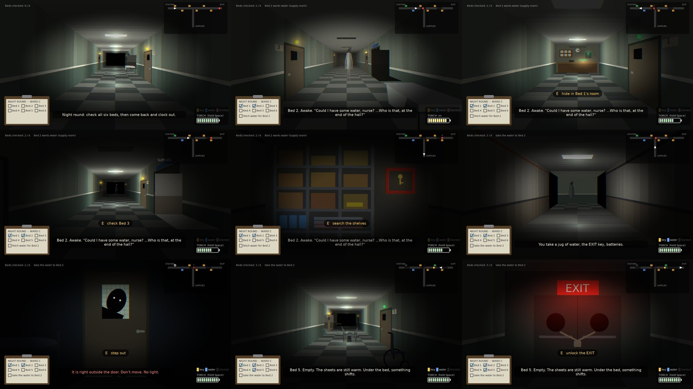
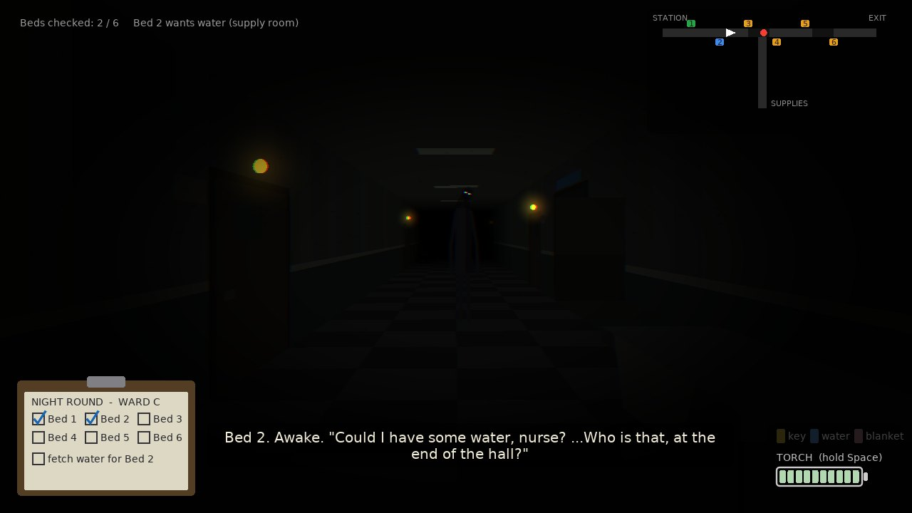
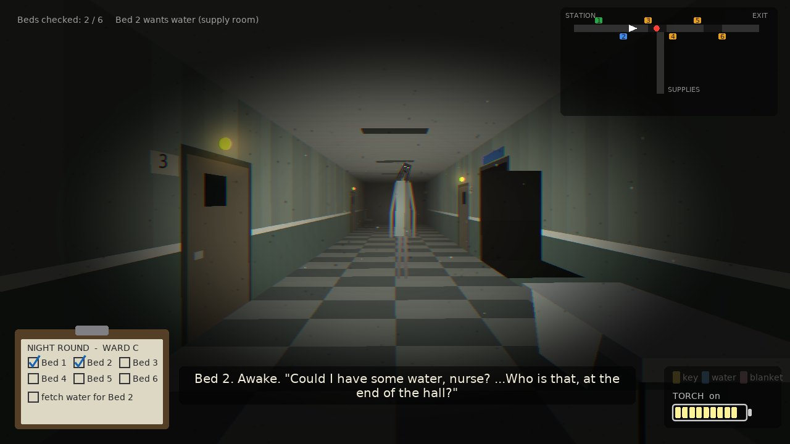
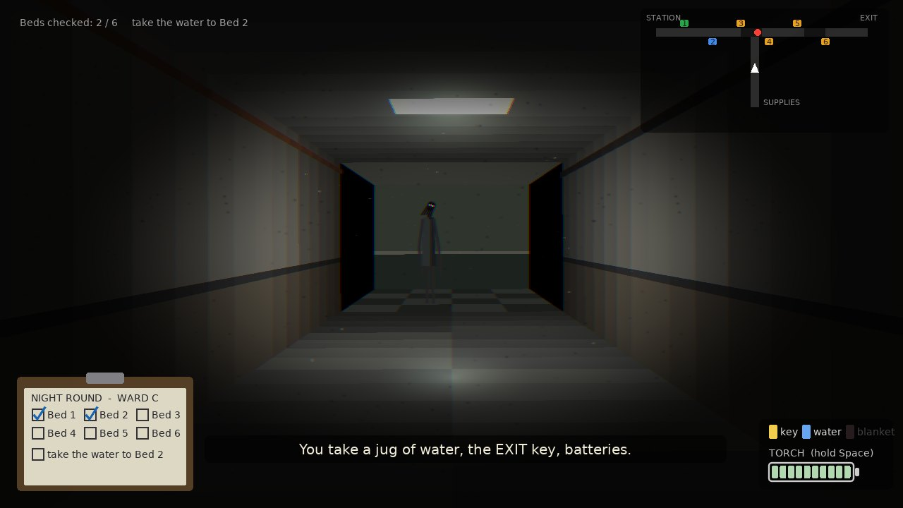
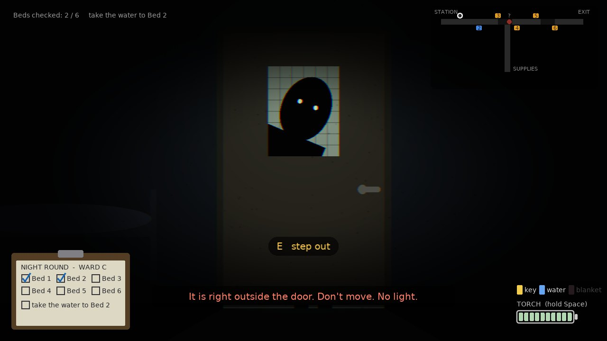
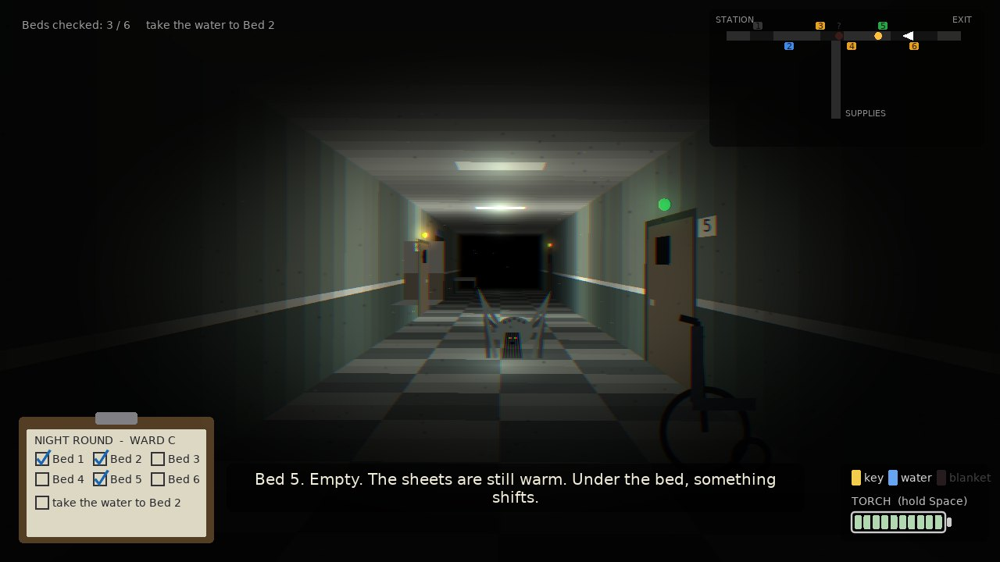
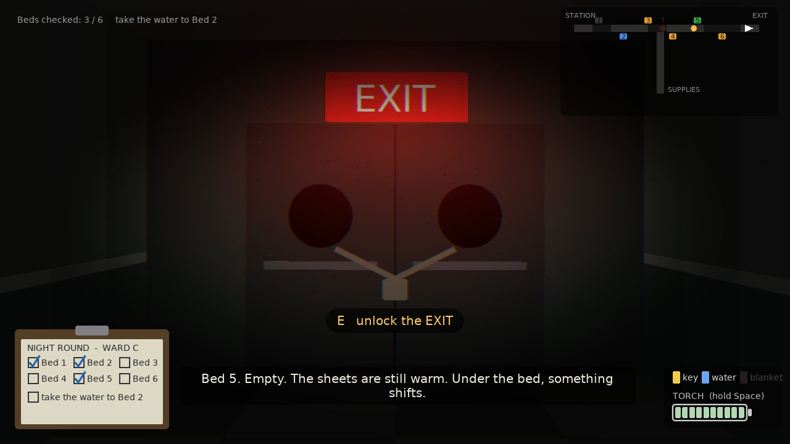

# Ward C: Night Shift (prototype)

A game mock-up grown out of the showcase's second Horror scene
([`style-showcase/scenes/horror_hallway.lua`](../style-showcase/scenes/horror_hallway.lua)):
the flickering hospital corridor with something at the far end. Same look, same hand-made
perspective, but now you walk it. No image or sound files; everything is drawn and
synthesized by code.



## The idea

You are the night nurse. Check all six beds, fetch what two of the patients ask for, then
walk back to the station and clock out. Or find the key and leave by the EXIT.

One rule runs the whole game: **they only move in the dark.**

| "Dark" means | What happens |
|---|---|
| A blackout (the lamps stutter for half a second first) | It walks toward you until the power is back. |
| You are not looking: leaning into a room, searching the shelves, working the padlock, turning around, or simply having your back to it | It comes for you at a steady pace. |
| A stretch of corridor whose lamps have died (each bed you check costs the ward one lamp) | It creeps through that stretch even while you watch. |

If one gets within arm's reach, the shift is over.

### What you can do about it

| | |
|---|---|
| **Torch** (hold Space) | Freezes a figure you are facing, even in a blackout. Held on it for a second, it recoils 9 units back toward where it lives. A full battery is 5 seconds of torch. Spares: Bed 3, Bed 6, and the supply shelves (+50% each). |
| **Back away** (S) | Slower than walking, but you keep facing it, so it stays frozen in the light. |
| **Turn around** (Q) | You walk faster than you back away, and it follows whatever you turn your back on. |
| **Hide** (E at a bed you have already checked) | You shut yourself in the room. It comes to the door, waits outside for a few seconds (don't use the torch), then gives up. Each room's lock holds once. You can't hide with one of them within 3 units: it would see where you went. |

### The ward

```
 STATION   Bed 1           Bed 3           Bed 5               EXIT
    |===========================================================|
                   Bed 2        |   Bed 4           Bed 6
                                |
                                |  side corridor
                            SUPPLIES   (water, blankets, the EXIT key, batteries)
```

- **Bed 2** asks for water and **Bed 4** needs a blanket. Both are on the supply shelves at the
  end of the side corridor. The round is not done until they have been delivered.
- **Figure A** starts in front of the EXIT. Every time you hide and it loses you, it searches
  on past your door and **settles at the other end of the ward**. So hiding is also how you
  get it away from the EXIT, or away from the station.
- **Bed 5 is empty.** Checking it wakes **figure B**, which lives under that bed. After that
  it can crawl out during any blackout, usually behind you. The torch sends it scuttling
  back toward Bed 5 (and under it, if it is near enough); if you hide, it gives up and goes
  back under the bed for a while.
- You can see a figure that is standing in the junction from inside the side corridor (and
  the other way round), but not one that is further round the corner.

### Two ways out

| Ending | Needs |
|---|---|
| **Clock out** at the station | All six beds checked, water and blanket delivered, and nothing standing at the station. |
| **Leave by the EXIT** | The key from the supply shelves, nothing standing in front of the doors, and 2.5 seconds with your back to the corridor. You can do this at any time; the ending tells you what you left undone. |

|  |  |
|---|---|
| Blackout: only its eyes, and they are getting bigger. | The torch freezes it, then drives it back. |
|  |  |
| Coming back from the supply room. | Hiding. It is outside the door. |
|  |  |
| The one from under Bed 5, behind you. | The other way out. |

## Run it

From the repository root:

```bash
love ward-c
```

| Command | What it does |
|---|---|
| `love ward-c` | Play. |
| `love ward-c --mute` | Play without sound. |
| `love ward-c --selftest` | Checks the rules, then bots play 40 shifts each (see below). Exit code 0 means it passed. |
| `love ward-c --snapshots` | Saves the screenshots in `docs/` as PNGs, then quits. |

**Controls**

| Key | |
|---|---|
| **W** / Up | walk the way you are facing |
| **S** / Down | back away (slower, still facing the same way) |
| **Q** (or A, D, Tab, middle click) | turn around |
| **Space** (or Shift, left mouse button), held | torch |
| **E** (or Enter, right click) | use the nearest thing in front of you: check a bed, deliver, hide, step out, turn into the side corridor, search the shelves, unlock the EXIT, clock out. The prompt on screen says which. |
| R | restart after a shift ends |
| Esc / F11 | title / fullscreen |

**On screen:** the clipboard (bottom left) lists beds and requests. The ward plan (top right)
shows you as an arrow, doors coloured like their call lights, dead-lamp stretches, and each
figure **only where you last saw it** (the dot fades and gets a "?" as the sighting gets
old). Call lights above the doors: amber blinking = not checked, blue = the patient is
waiting for something, green = checked and you can still hide there, dark = lock used.

## How it's built

```
main.lua          window, input, title, --snapshots
src/game.lua      ALL the rules, no drawing: the ward's geometry, lamps, blackouts, both
                  figures, beds, requests, hiding, the two endings
src/render.lua    the first-person corridors, room and hiding views, HUD, ward plan, screens
src/sfx.lua       sounds synthesized at start-up (hum, footsteps, heartbeat, sting...)
src/selftest.lua  rule checks and the bots
lib/              moonshine (film grain, colour fringing, vignette) and shack (shake)
```

- **The corridor** is the showcase scene with a camera: a point at `z` lands on screen at
  `vanishing point + (x, y) * size / depth`, with `depth = facing * (z - yourZ)`. Turning
  around is flipping the sign of `facing`; left and right swap by themselves. Each corridor
  is cut into thin slices along `z`, painted in the brightness the game reports for that
  spot (`game:lightAt(segment, z)` = lamps + torch). Doors, lamps, props and figures are
  sorted far to near. Beyond 15 units everything fades to black.
- **The ward is two straight segments** joined at one junction. A position is
  `(segment, distance along it)`; `game:pathDist` measures through the junction and
  `game:stepToward` walks a figure along that path. That is all the "map" there is, which
  is why adding the side corridor did not need a 3D engine: you are always looking down one
  straight corridor, and turning into the other one is a cut.
- **The rules never look at the screen.** `src/game.lua` is plain numbers, which is why
  bots can play it without a window.
- **Tuning numbers** are the constants at the top of `src/game.lua` (speeds, battery drain,
  how long each action takes, how long it waits at a door), the bed list and the order in
  which lamps die (`DYING`).

## What was and wasn't tested

`--selftest` passes: 46 rule checks, every view draws (both corridors facing both ways, room,
hiding, shelves, turning, caught, both endings), and bots play 40 shifts each:

| Bot | Result |
|---|---|
| Dutiful, perfect reflexes: does the whole round, torch when one is within 5.5 units (8 in the dark), hides when the battery is nearly gone | 40 / 40 shifts finished (38 clocked out, 2 had to use the EXIT because it had settled at the station and no locks were left). About 83 s, 30% battery left, 6 torch recoils and 2 hides per shift. |
| The same, with the torch 0.4 s late and key presses 0.25 s late | 27 / 40 finished, 13 caught. About 116 s, 8% battery left. |
| Escaper: two beds, the key, one hide to send it to the far end, out by the EXIT | 40 / 40, about 67 s, battery nearly empty. |
| Reckless: does the round, never uses the torch, never hides | caught every time, around the fourth bed (15 s). |
| Idle: stands at the station | caught every time, after about 100 s. |

That says both endings are reachable and that ignoring the rule is fatal. It does not say it
is fun or how hard it feels: **nobody has played it by hand**. It was built in a container
with no GPU, sound card or keyboard, so frame rate, the sounds and the feel of the controls
are untested. The bots also know exactly where both figures are at all times; a person only
has the ward plan's last sightings and the pulse at the edge of the screen. Expect it to be
harder for a person than the table suggests. If it is too hard, the first knobs are
`V_UNSEEN` (how fast they follow your back), `DRAIN` (battery) and `LINGER`.

Things that are simplified on purpose:

- You can only look straight along a corridor: there is no looking sideways and no free
  turning, so "what is in front of you" is always unambiguous.
- Coming out of the side corridor, you face the way you were facing when you went in.
- Hiding is safe as long as the lock has not been used and you keep the torch off. There is
  no noise meter or breath-holding.
- The side corridor's lamps never die; only the main corridor gets darker.

## Ideas if this grows further

- More junctions (the two-segment path code generalises to a graph of corridors).
- Patients who call you back mid-round, so the order can't be planned in advance.
- Sound as information: its footsteps panned and muffled by distance, so you can judge what
  is behind you without the plan.
- A second floor, with the EXIT as the staircase.
