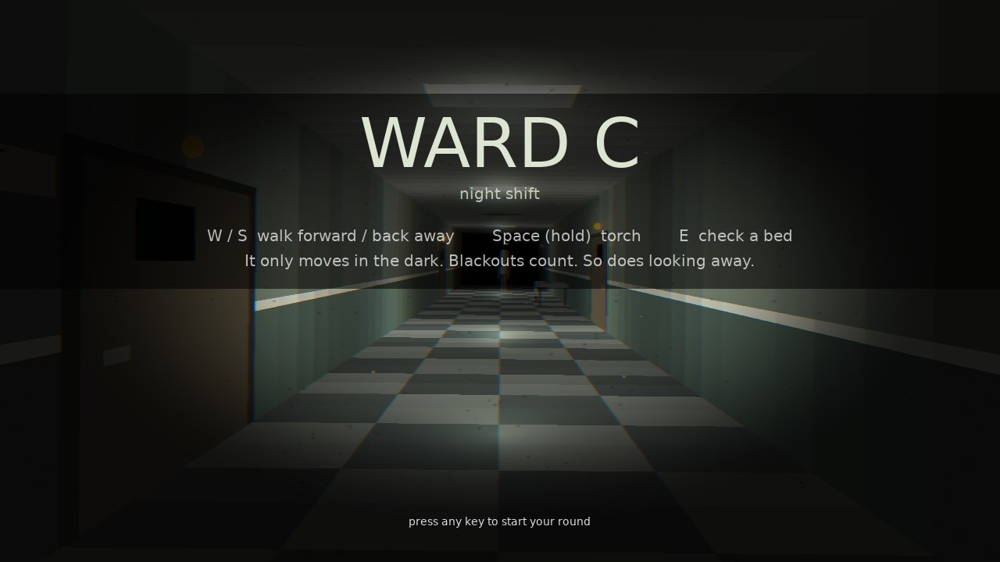
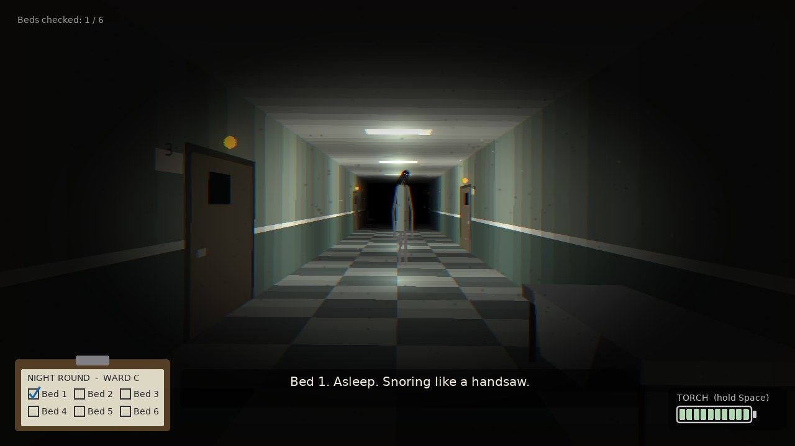
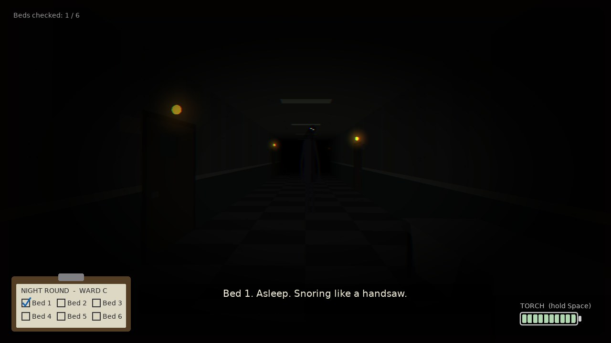
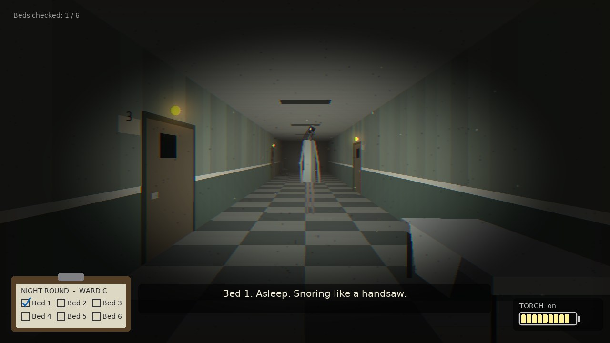
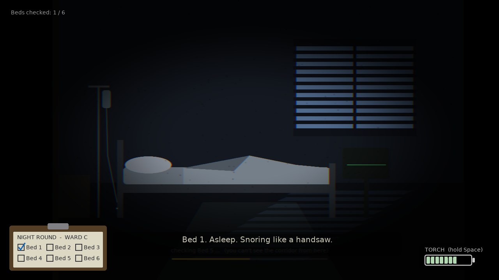

# Ward C: Night Shift (prototype)

A quick game mock-up of the showcase's second Horror scene
([`style-showcase/scenes/horror_hallway.lua`](../style-showcase/scenes/horror_hallway.lua)):
the flickering hospital corridor with something at the far end. Same look, same hand-made
perspective, but now you walk it. No image or sound files; everything is drawn and
synthesized by code.



## The idea

You are the night nurse. Check all six beds along the corridor, then walk back to the
station and clock out. One rule runs the whole game:

**It only moves in the dark.**

| "Dark" means | What happens |
|---|---|
| A blackout (the lamps stutter for half a second first) | It walks toward you until the power is back. |
| You lean into a room to check a bed (2.2 s, you can't see the corridor) | It comes about 3.5 units closer. |
| A stretch of corridor whose lamps have died (each bed you check costs the ward one lamp) | It creeps through that stretch even while you watch. |

Your torch counts as light. Hold it on the figure and it freezes, even in a blackout; keep it
there for a second and it recoils 9 units back down the corridor. A full battery is 5 seconds
of torch. Beds 3 and 6 have spare batteries (+50% each).

If it gets within arm's reach, the shift is over.

|  |  |
|---|---|
| Lights on: it stands still. | Blackout: only its eyes, and they are getting bigger. |
|  |  |
| The torch freezes it, then drives it back. | Checking a bed means looking away. |

## Run it

From the repository root:

```bash
love ward-c
```

| Command | What it does |
|---|---|
| `love ward-c` | Play. |
| `love ward-c --mute` | Play without sound. |
| `love ward-c --selftest` | Checks the rules, then bots play 40 shifts each (see below). Exit code 0 means it passed. |
| `love ward-c --snapshots` | Saves the screenshots in `docs/` as PNGs, then quits. |

**Controls:** **W** / Up walk forward, **S** / Down back away (slower, but you keep facing
it), hold **Space** (or Shift, or the left mouse button) for the torch, **E** (or Enter, or
right click) to check the bed you are standing next to and to clock out at the station,
**R** to restart after a shift ends, Esc for the title, F11 fullscreen.

## How it's built

```
main.lua          window, input, title, --snapshots
src/game.lua      ALL the rules, no drawing: lamps, blackouts, the figure, beds, battery
src/render.lua    the first-person corridor, the room view, HUD, end screens
src/sfx.lua       sounds synthesized at start-up (hum, footsteps, heartbeat, sting...)
src/selftest.lua  rule checks and the bots
lib/              moonshine (film grain, colour fringing, vignette) and shack (shake)
```

- **The corridor** is the showcase scene with a camera: a point at depth `z` lands on
  screen at `vanishing point + (x, y) * size / (z - cameraZ)`. The corridor is cut into thin
  slices along `z`; each slice is painted in the brightness the game reports for that depth
  (`game:lightAt(z)` = lamps + torch). Doors, lamps, props and the figure are sorted far to
  near and drawn the same way. Beyond 15 units everything fades to black.
- **The rules never look at the screen.** `src/game.lua` is plain numbers (where you are,
  where it is, how bright each lamp is), which is why bots can play it without a window.
- **Tuning numbers** are the constants at the top of `src/game.lua` (`PEEK_TIME`, `DRAIN`,
  `REPEL_TIME`, `REPEL_DIST`...), the bed list and the order in which lamps die (`DYING`).

## What was and wasn't tested

`--selftest` passes: 15 rule checks, every screen draws, and four bots play 40 shifts each.

| Bot | Result |
|---|---|
| Careful, perfect reflexes (torch when it is within 5.5 units, or 8 in the dark) | 40 / 40 shifts finished, about 40 s each, about half the battery left |
| The same, reacting 0.4 s late | 38 / 40 finished, about 30% battery left |
| Reckless (does the round, never uses the torch) | caught every time, around the fourth bed |
| Idle (stands at the station) | caught every time, after about 95 s |

That says the game is winnable and that ignoring the rule is fatal. It does not say it is
fun or how hard it feels: nobody has played it by hand. It was built in a container with no
GPU, sound card or keyboard, so frame rate, the sounds and the feel of the controls are
untested. A first shift will probably run one to two minutes. If it turns out too easy or
too hard, `DRAIN` (battery) and the figure's speeds in `G:updateFigure` are the first knobs.

## Ideas if this grows

- Turning around (walking back with your back to it would be faster, and worse).
- Rooms you can hide in; a second figure; a ward map with side corridors.
- Patients who need something (water, a blanket), so the round isn't a straight line.
- The EXIT doors at the far end as a second way out.
